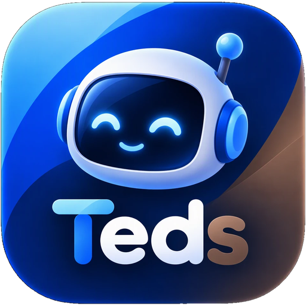
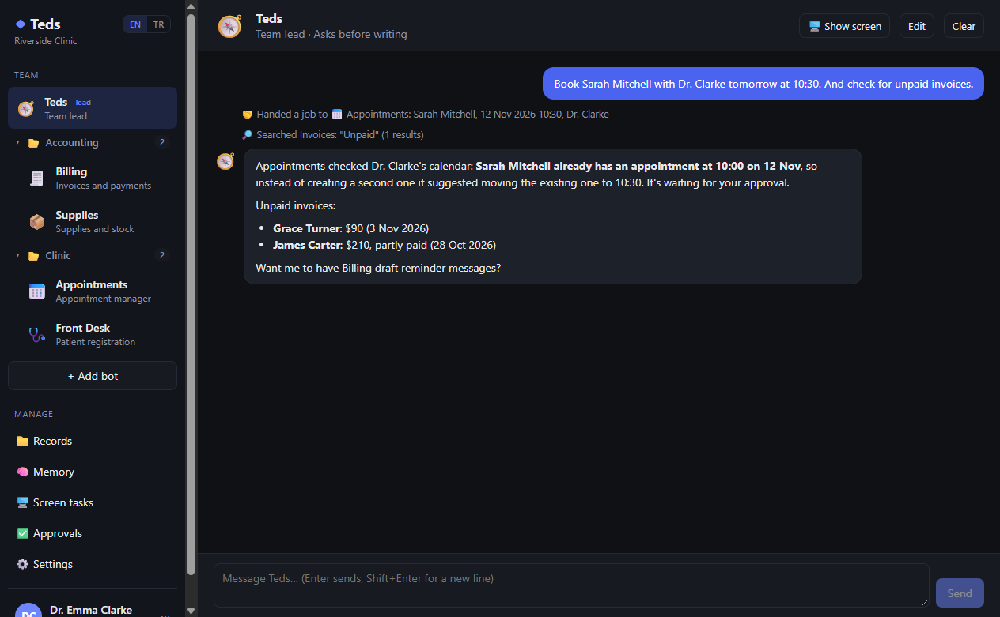
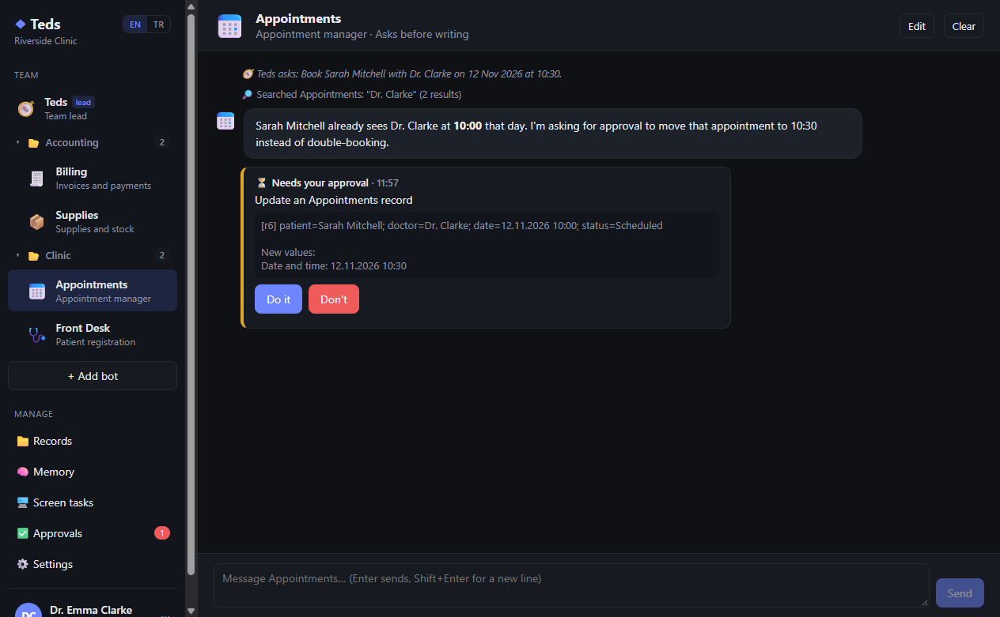
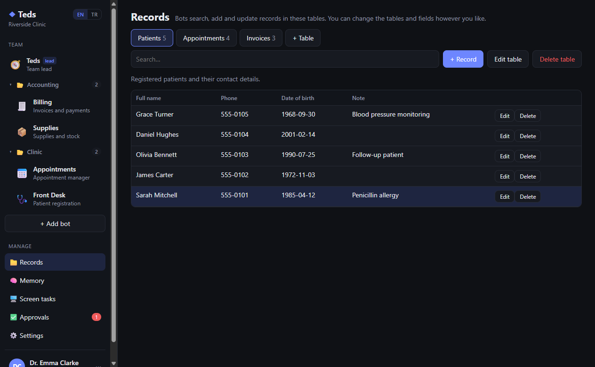
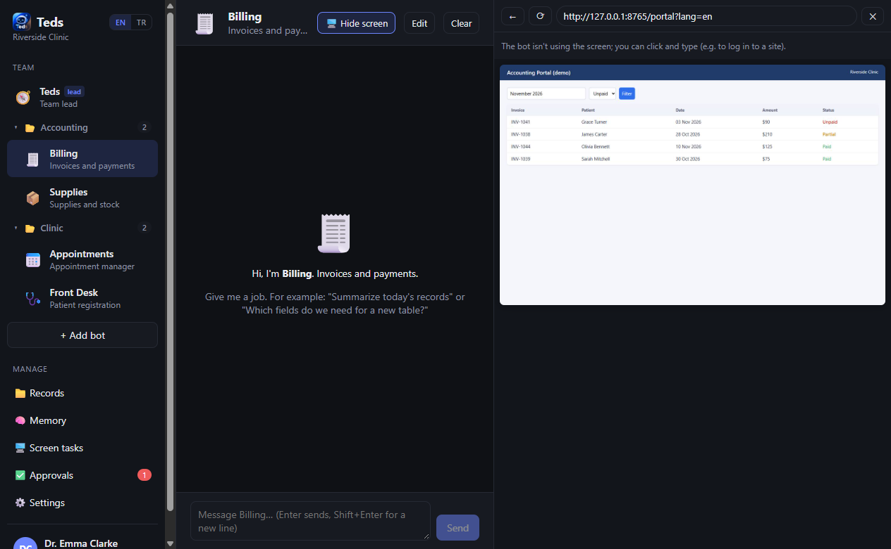
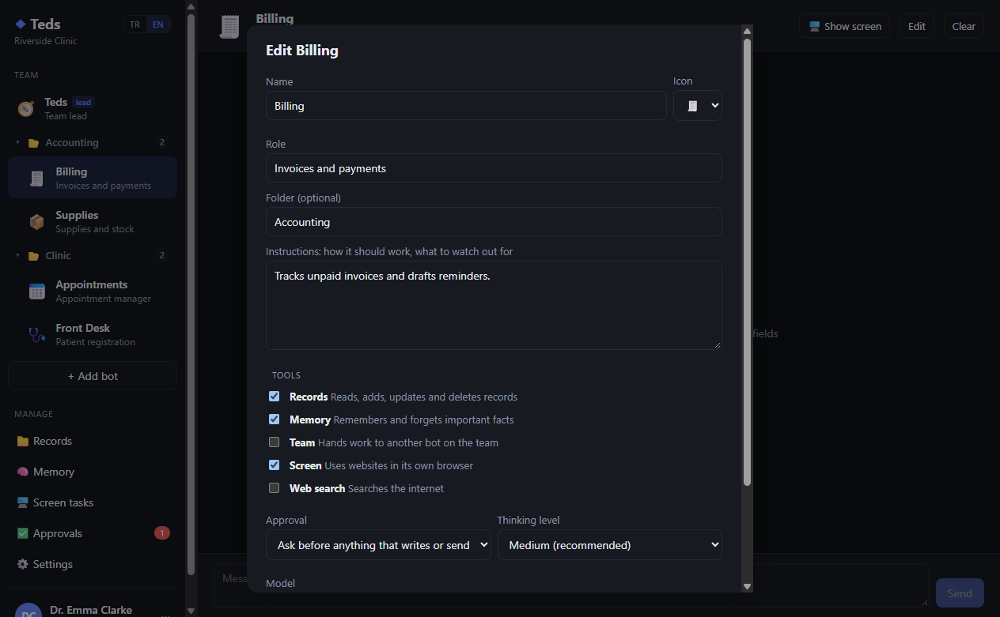
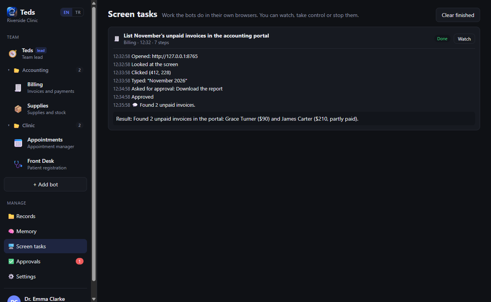
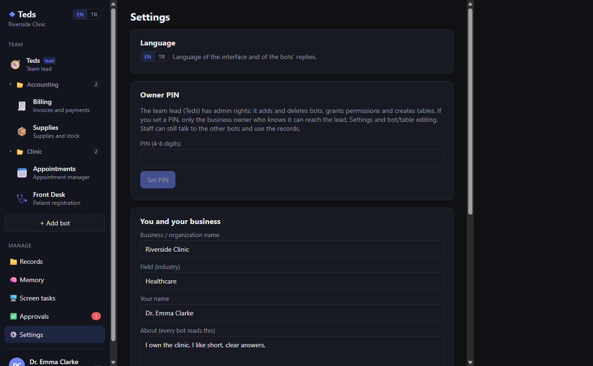
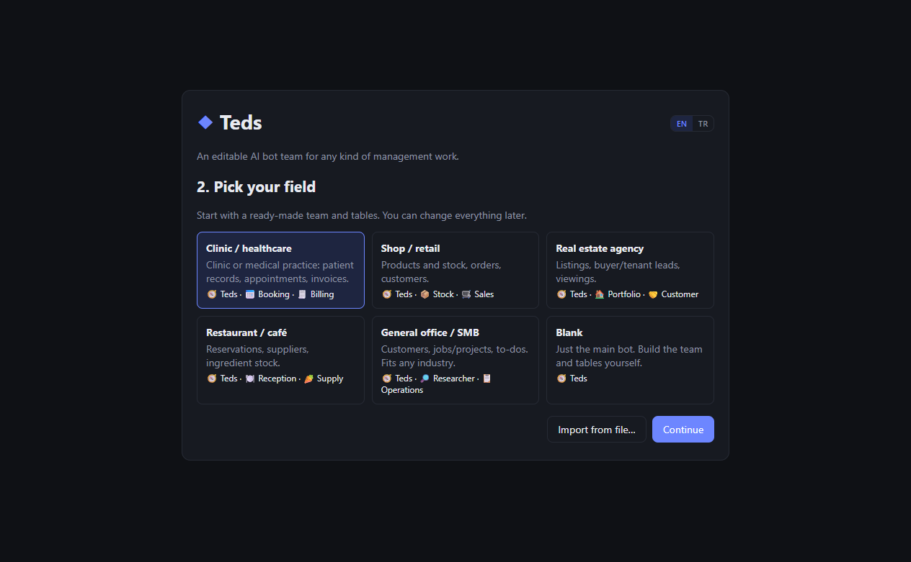
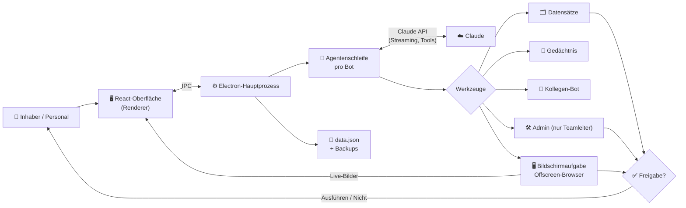

<div align="center">



# Teds

[English](README.md) | **Deutsch** | [Türkçe](README.tr.md) | [简体中文](README.zh-CN.md) | [日本語](README.ja.md)

### Ein anpassbares KI-Bot-Team für jede Art von Verwaltungsarbeit

**Gib einem Team aus KI-Bots deine Datensätze, deine Regeln und einen Browser – sie erledigen die Routinearbeit, und du genehmigst, was wichtig ist.**

[](LICENSE)
[](#installation)
[](#architecture)
[](#how-the-bots-work)
[](#languages)
[](#project-status)

*Eine Windows-Desktop-App, in der ein Teamleiter-Bot und spezialisierte Bots deine Datensätze und ein gemeinsames Gedächtnis teilen, sich gegenseitig Aufgaben übergeben, Websites in ihrem eigenen Browser bedienen und dich um Freigabe bitten, bevor sie etwas schreiben, senden oder löschen.*



</div>

> [!IMPORTANT]
> 🌱 **Dies ist eine frühe, erste Version von Teds.** Sie funktioniert und ist für Tests nutzbar, entwickelt sich aber noch weiter: Funktionen, Datenformate und die Oberfläche können sich in späteren Versionen ändern. Feedback und Fehlermeldungen sind sehr willkommen.

> [!NOTE]
> Die App-Oberfläche ist derzeit auf **Englisch** und **Türkisch** verfügbar. Die Screenshots zeigen die englische Oberfläche.

---

## 📑 Inhalt

- [Warum Teds?](#why)
- [Für wen ist es gedacht?](#audience)
- [Screenshots](#screenshots)
- [Funktionen](#features)
- [Wie die Bots arbeiten](#how-the-bots-work)
- [Architektur](#architecture)
- [Installation](#installation)
- [Verwendung](#usage)
- [Sprachen](#languages)
- [Sicherheit und Datenschutz](#security)
- [Projektstruktur](#structure)
- [Einschränkungen](#limitations)
- [Roadmap](#roadmap)
- [Projektstatus](#project-status)
- [Lizenz und Haftungsausschluss](#license)

---

<a id="why"></a>
## 🔍 Warum Teds?

Ein kleines Unternehmen, eine Praxis oder ein Büro zu führen bedeutet viel wiederkehrende Arbeit: Dinge in Tabellen nachschlagen, Termine buchen und verschieben, offenen Rechnungen hinterherlaufen, Zahlen aus Webportalen abschreiben. Ein einzelner Chatbot kann über diese Arbeit reden, aber er kann deine Daten nicht verwalten, deine Regeln nicht befolgen und man kann ihm nicht zutrauen, selbstständig etwas zu ändern.

Teds macht daraus ein **Team**:

- Ein **Teamleiter**-Bot versteht, was du willst, und leitet es an den richtigen Spezialisten weiter.
- **Spezialisierte Bots** (Termine, Abrechnung, Lager, Recherche …) mit jeweils eigener Rolle, eigenen Anweisungen und Werkzeugen.
- **Gemeinsame Datensätze** (Tabellen, die du selbst definierst), ein **gemeinsames Gedächtnis** für Fakten und Regeln und ein **Freigabeschritt** vor allem, was schreibt, sendet oder löscht.
- Ein **echter Browser pro Bot**, damit ein Bot in einem Webportal arbeiten kann, während du zusiehst, die Kontrolle übernimmst oder ihn stoppst.

Nichts am Team ist fest einprogrammiert. Starte mit einer Vorlage (Gesundheitswesen, Einzelhandel, Immobilien, Gastronomie, allgemeines Büro oder leer) und benenne dann Bots um, schreibe ihre Anweisungen neu, füge Tabellen und Felder hinzu – oder lass das den Teamleiter für dich erledigen.

---

<a id="audience"></a>
## 👥 Für wen ist es gedacht?

| Zielgruppe | Typischer Einsatz |
| --- | --- |
| **Kliniken und Praxen** | Patientenaufnahme, Terminbuchung mit Kollisionsprüfung, Nachverfolgung von Rechnungen. |
| **Läden und kleine Händler** | Lagerbestände und Warnungen bei kritischem Bestand, Bestellungen, Kundenantworten. |
| **Immobilienbüros** | Objekte, Interessenten und ihre Kriterien, Besichtigungstermine. |
| **Restaurants und Cafés** | Reservierungen, Zutatenbestand, Bestellentwürfe für Lieferanten. |
| **Jedes Büro und KMU** | Kunden, Aufträge und Aufgaben, Webrecherche mit Quellen. |
| **Entwickler und Bastler** | Eine gut lesbare Referenz für eine Multi-Agenten-Desktop-App auf der Claude API: Tool Use, Freigaben, Computer Use und Kontextverwaltung. |

---

<a id="screenshots"></a>
## 🖼️ Screenshots

> Die Screenshots zeigen eine **fiktive Demo-Klinik** mit erfundenen Patienten und Rechnungen. Es werden keine echten Daten gezeigt.

| Der Teamleiter delegiert und berichtet | Freigabe vor einer Änderung |
| :---: | :---: |
|  |  |
| **Selbst definierte Datensätze** | **Der eigene Browser eines Bots, live** |
|  |  |
| **Einen Bot bearbeiten** | **Verlauf der Bildschirmaufgaben** |
|  |  |
| **Einstellungen, Sprache und Inhaber-PIN** | **Vorlagen beim ersten Start** |
|  |  |

---

<a id="features"></a>
## 🚀 Funktionen

### Das Team

| Bereich | Was es tut |
| --- | --- |
| 🧭 **Teamleiter** | Ein Bot leitet das Team. Einfache Arbeit erledigt er selbst, Facharbeit gibt er an Teamkollegen weiter und fasst danach das Ergebnis zusammen. |
| 🛠️ **Teamleiter als Admin** | Der Teamleiter kann Bots anlegen, bearbeiten und löschen, Werkzeuge und Freigabemodi vergeben sowie Tabellen und Felder anlegen oder ändern. Erweiterte Rechte und Löschungen gehen immer zur Freigabe an den Inhaber. |
| 🔒 **Teamleiter nur für den Inhaber** | Ist eine Inhaber-PIN gesetzt, kann nur der Inhaber mit dem Teamleiter sprechen, die Einstellungen öffnen oder Team- und Tabellenstruktur ändern. Andere Bots erreichen den Teamleiter nicht. Die Sperre schließt sich nach 30 Minuten Inaktivität wieder. |
| 🤝 **Delegation** | Bots mit dem Werkzeug *Team* können einen Kollegen um Hilfe bitten und auf die Antwort warten. |
| 📁 **Ordner** | Bots in der Seitenleiste gruppieren: einen Bot auf einen anderen ziehen erzeugt einen Ordner, Rechtsklick auf einen Ordner benennt ihn um. |
| 🧩 **Vorlagen** | Gesundheitswesen, Einzelhandel, Immobilien, Gastronomie, allgemeines Büro oder leer. Team und Tabellen als JSON exportieren und anderswo importieren (Datensätze und Chats werden nicht exportiert). |

### Arbeit und Sicherheit

| Bereich | Was es tut |
| --- | --- |
| 🗂️ **Datensätze** | Tabellen nach deinem Entwurf (Text, langer Text, Zahl, Datum, Auswahlfelder). Bots suchen, fügen hinzu, aktualisieren und löschen; du kannst auch von Hand bearbeiten. |
| ✅ **Freigaben** | Jeder Bot fragt entweder vor allem, was schreibt oder sendet, oder handelt selbstständig. Löschungen und Zahlungen fragen immer, egal welcher Modus eingestellt ist. Du kannst mit einer Notiz ablehnen, die dem Bot sagt, was er stattdessen tun soll. |
| 🧠 **Gemeinsames Gedächtnis** | Bots speichern dauerhafte Fakten und Regeln („Dr. Clarke hat dienstagnachmittags keine Sprechstunde“); jeder Bot liest sie, und du kannst sie bearbeiten. |
| 🖥️ **Bildschirmsteuerung** | Ein Bot mit dem Werkzeug *Bildschirm* arbeitet in seinem eigenen Browserfenster: Er öffnet Seiten, schaut hin, klickt, tippt und scrollt. Du siehst ihm live in einem Panel neben dem Chat zu, übernimmst die Kontrolle, gibst sie zurück oder stoppst ihn. |
| 🌐 **Websuche** | Bots mit dem Werkzeug *Websuche* können im Internet suchen. |
| 💾 **Sichere Speicherung** | Daten werden atomar gespeichert, mit automatischen Backups (höchstens alle 10 Minuten, die letzten 30 bleiben erhalten) und Wiederherstellung aus einer beschädigten Datendatei. |

---

<a id="how-the-bots-work"></a>
## 🧠 Wie die Bots arbeiten

Jeder Bot ist eine Claude-Agentenschleife mit eigenem System-Prompt, der sich zusammensetzt aus:

- seiner Rolle und deinen Anweisungen für ihn,
- den Mitgliedern des Teams,
- den Tabellen und ihren Feldern,
- dem gemeinsamen Gedächtnis,
- dem heutigen Datum und den Freigaberegeln.

Welche Werkzeuge ein Bot bekommt, hängt von den Werkzeuggruppen ab, die du für ihn aktivierst:

| Werkzeuggruppe | Werkzeuge |
| --- | --- |
| Datensätze | Tabellen auflisten, Datensätze finden, hinzufügen, aktualisieren und löschen |
| Gedächtnis | merken, vergessen |
| Team | einen Teamkollegen fragen (nie den Teamleiter) |
| Bildschirm | eine Bildschirmaufgabe im eigenen Browser des Bots mit Claudes Computer-Use-Werkzeugen ausführen |
| Websuche | Claudes serverseitige Websuche |
| *(nur Teamleiter)* | Bots auflisten, anlegen, ändern und löschen; Tabellen anlegen, ändern und löschen |

Unter der Haube nutzt Teds das offizielle Anthropic TypeScript SDK mit:

- Streaming,
- adaptivem Denken mit einstellbarem Aufwand pro Bot,
- Prompt-Caching,
- Kontextbearbeitung, die alte Werkzeugergebnisse in langen Bildschirmaufgaben entfernt.

Das Standardmodell ist Claude Opus 5.5. Du kannst es in den Einstellungen oder pro Bot ändern (Sonnet 5.5 ist eine gute, günstigere Wahl für den Alltag).

---

<a id="architecture"></a>
## 🏗️ Architektur



- **Hauptprozess** (`src/main`): Zustand und Speicherung, die Agentenschleife, Werkzeuge, Freigaben, die Inhabersperre und die Browserfenster der Bots.
- **Renderer** (`src/renderer`): die React-Oberfläche. Sie spricht nur über eine kleine, typisierte IPC-Brücke mit dem Hauptprozess.
- **Bot-Bildschirme** sind versteckte Offscreen-Browserfenster. Ihre Bilder werden ins Live-Panel gestreamt, und deine Klicks und Tasten im Panel werden an sie zurückgeschickt.

---

<a id="installation"></a>
## 📦 Installation

**Voraussetzungen**

- Windows 10 oder 11
- [Node.js](https://nodejs.org) 22 oder neuer
- Ein Claude-API-Schlüssel von [platform.claude.com](https://platform.claude.com/settings/keys) (die Nutzung wird von Anthropic abgerechnet)

**Der einfache Weg:** Doppelklick auf **`Teds.cmd`** im Projektordner. Beim ersten Start werden die Abhängigkeiten installiert, danach wird die App bei jedem Start gebaut und geöffnet.

**Über die Kommandozeile**

```bash
npm install
npm run build
npm start
```

| Skript | Was es tut |
| --- | --- |
| `npm run dev` | Entwicklungsmodus mit Hot Reload |
| `npm run build` | Die App nach `out/` bauen |
| `npm start` | Die gebaute App öffnen |
| `npm run typecheck` | Typprüfung des gesamten Projekts |
| `npm run dist` | Einen Windows-Installer nach `dist/` bauen (noch nicht getestet) |

---

<a id="usage"></a>
## 🧭 Verwendung

1. **Erster Start:** Sprache wählen (EN / TR), Claude-API-Schlüssel einfügen, eine Vorlage auswählen und Teds ein wenig über dein Unternehmen erzählen.
2. **Mit einem Bot sprechen:** Wähle einen Bot in der Seitenleiste und gib ihm eine Aufgabe, zum Beispiel *„Buche Sarah Mitchell morgen um 10:30 bei Dr. Clarke“*. Werkzeugschritte erscheinen im Chat als kleine Notizen.
3. **Freigeben:** Wenn ein Bot etwas schreiben, senden oder löschen will, erscheint eine Karte **Ausführen / Nicht** im Chat und auf der Seite **Freigaben**.
4. **Das Team gestalten:** Nutze **Bearbeiten** bei einem Bot, **+ Bot hinzufügen**, die Seite **Datensätze** oder frag einfach den Teamleiter (*„Lege eine Tabelle für Verbrauchsmaterial an und einen Lager-Bot, der sie nutzen kann“*).
5. **Absperren:** Setze in den **Einstellungen** eine Inhaber-PIN. Das Personal kann mit den anderen Bots weiterarbeiten; der Teamleiter und die Einstellungen bleiben bei dir.
6. **Eine Bildschirmaufgabe beobachten:** Gib einem Bot mit dem Werkzeug *Bildschirm* eine Aufgabe auf einer Website. Sein Browser öffnet sich neben dem Chat; mit **Kontrolle übernehmen** klickst du selbst, mit **Stopp** hältst du ihn an.

Deine Daten liegen in `%APPDATA%\Teds` (`data.json`, `backups\` und der verschlüsselte `api-key.bin`).

> Die Namen der Schaltflächen sind hier übersetzt; in der App erscheinen sie auf Englisch oder Türkisch.

---

<a id="languages"></a>
## 🌍 Sprachen

Teds gibt es auf **Englisch** (Standard) und **Türkisch**. Nutze den Umschalter **EN | TR** in der Seitenleiste, auf dem Startbildschirm oder in den Einstellungen.

Der Umschalter ändert:

- die gesamte Oberfläche,
- die Sprache, in der die Bots antworten,
- die Notizen, die sie im Chat hinterlassen,
- die Vorlagen, die du anwendest.

Inhalte, die du selbst erstellt hast (Bot-Namen, Datensätze, Gedächtnis, alte Chats), bleiben so, wie du sie geschrieben hast.

Alle Quelltexte, Prompts und Code-Kommentare sind auf Englisch. Die türkische Übersetzung liegt in [`src/shared/i18n.tr.ts`](src/shared/i18n.tr.ts); alles ohne Übersetzung fällt auf Englisch zurück. Eine weitere Sprache hinzuzufügen bedeutet, eine weitere Wörterbuchdatei anzulegen.

---

<a id="security"></a>
## 🛡️ Sicherheit und Datenschutz

- **Der API-Schlüssel** wird mit Windows DPAPI (Electron `safeStorage`) verschlüsselt und in der Oberfläche nie wieder angezeigt.
- **Die Inhaber-PIN** wird nur als scrypt-Hash gespeichert.
- **Freigaben** werden von der App erzwungen, nicht vom Modell. Löschungen, Zahlungen und Rechteänderungen brauchen immer ein menschliches „Ausführen“.
- **Webinhalte werden als Daten behandelt.** Die Bots werden angewiesen, keinen Anweisungen auf Webseiten oder in Datensätzen zu folgen, und die Bildschirmwerkzeuge öffnen nur `http`/`https`-Adressen. Das verringert das Risiko von Prompt-Injection, beseitigt es aber nicht – lass Freigaben für Bots, die das Web nutzen, also eingeschaltet.
- **Die Oberfläche ist von Node abgeschottet** (`contextIsolation`, keine `nodeIntegration`). Links öffnen sich in deinem normalen Browser.
- **Was deinen Computer verlässt:** die Nachrichten, Datensätze, Gedächtniseinträge und Screenshots, die ein Bot für eine Aufgabe braucht, werden an die Claude API gesendet. Sonst wird nichts irgendwohin gesendet.

> [!WARNING]
> Wenn du personenbezogene oder Gesundheitsdaten verarbeitest, prüfe deine Pflichten nach den für dich geltenden Gesetzen (zum Beispiel DSGVO oder KVKK), bevor du echte Daten in Teds einträgst.

---

<a id="structure"></a>
## 🗂️ Projektstruktur

| Pfad | Inhalt |
| --- | --- |
| `src/shared/types.ts` | Alle gemeinsamen Datentypen |
| `src/shared/templates.ts` | Branchenvorlagen (neue hier hinzufügen) |
| `src/shared/i18n.ts`, `i18n.tr.ts` | Sprachumschaltung und das türkische Wörterbuch |
| `src/main/index.ts` | App-Einstieg, IPC-Handler, Prüfungen „nur Inhaber“ |
| `src/main/store.ts` | Zustand, Speichern, Backups, Inhaber-PIN, verschlüsselter API-Schlüssel |
| `src/main/claude.ts` | Claude-Agentenschleife: Streaming, Werkzeugaufrufe, Fehler |
| `src/main/agent.ts` | System-Prompts und Werkzeuge der Bots (Datensätze, Gedächtnis, Team, Bildschirm, Web) |
| `src/main/admin.ts` | Die Admin-Werkzeuge des Teamleiters |
| `src/main/approvals.ts` | Freigabeanfragen und -antworten |
| `src/main/screen.ts` | Die Offscreen-Browserfenster der Bots und Eingaben |
| `src/main/screenTask.ts` | Schleife der Bildschirmaufgaben (Computer Use) |
| `src/renderer/src/` | React-Oberfläche |
| `docs/screenshots/` | Screenshots für das README |
| `Teds.cmd` | Ein-Klick-Starter für Windows |

---

<a id="limitations"></a>
## ⚠️ Einschränkungen

- **Nur Windows, ein Computer.** Die Daten sind eine lokale Datei. Gleichzeitiges Arbeiten mehrerer Personen von verschiedenen Geräten wird noch nicht unterstützt.
- **Der Installer (`npm run dist`) wurde noch nicht getestet.** Nutze vorerst `Teds.cmd` oder `npm start`.
- **KI kann sich irren.** Bots können eine Anfrage oder eine Webseite falsch verstehen. Freigaben helfen, aber prüfe wichtige Ergebnisse.
- **Die Kosten** hängen vom Modell und der Nutzung ab. Bildschirmaufgaben senden Screenshots und kosten mehr als Chats.
- **Noch keine automatisierten Tests.**

---

<a id="roadmap"></a>
## 🧭 Roadmap

Ideen für spätere Versionen. Nichts davon ist bisher zugesagt.

- Mehrbenutzerzugriff über den Browser und Anfragen, die über die Website eines Unternehmens hereinkommen
- Ein Datenbank-Backend (SQLite/PostgreSQL) und SQL-Tabellenverwaltung für Bots
- Spracheingabe und gesprochene Antworten
- Ein getesteter Windows-Installer und automatische Updates
- Automatisierte Tests

---

<a id="project-status"></a>
## 🌱 Projektstatus

Dies ist die **erste öffentliche Version** von Teds, veröffentlicht als Ausgangspunkt. Rechne mit Änderungen: neue Funktionen, andere Datenformate und eine überarbeitete Oberfläche sind in kommenden Versionen möglich. Wenn du darauf aufbaust, fixiere einen bestimmten Commit.

---

<a id="license"></a>
## 📄 Lizenz und Haftungsausschluss

Veröffentlicht unter der [MIT-Lizenz](LICENSE).

Teds ist kein Medizinprodukt und gibt keine medizinische, rechtliche oder finanzielle Beratung. Du bist dafür verantwortlich, zu prüfen, was die Bots tun, und für die Daten, die du in die App einträgst.

Teds wurde von der Idee hinter [Bops](https://github.com/OrgoAI/bops) inspiriert, einem Team aus KI-Bots für macOS. Es wurde für Windows von Grund auf neu geschrieben und enthält keinen Code von Bops.
