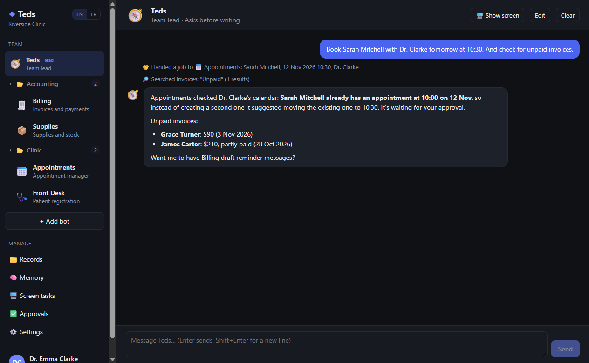
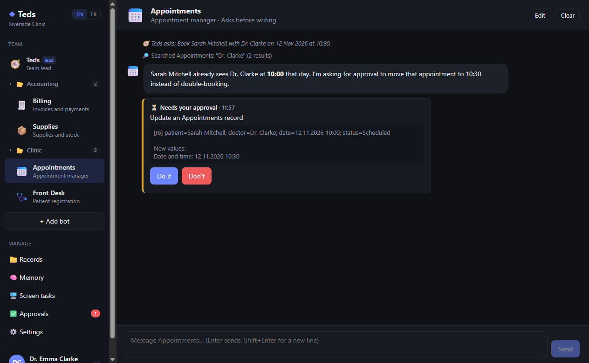
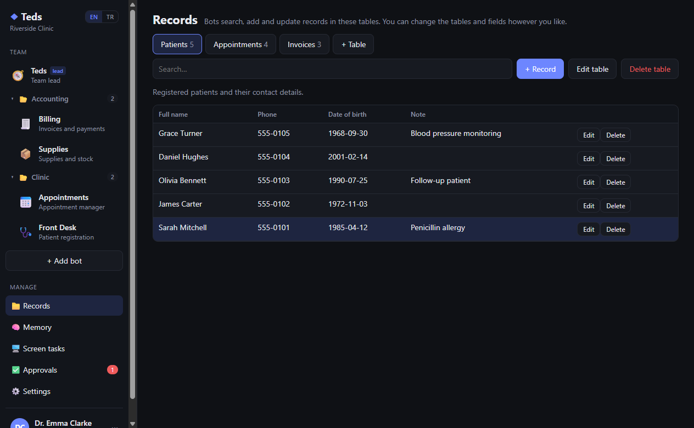
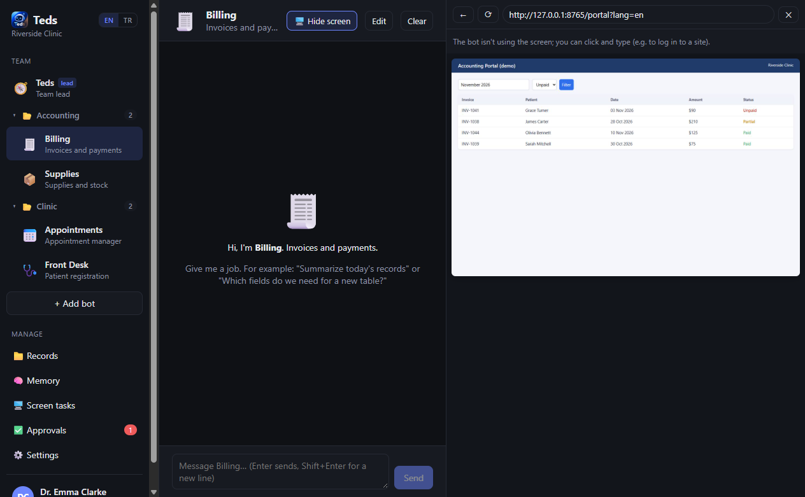
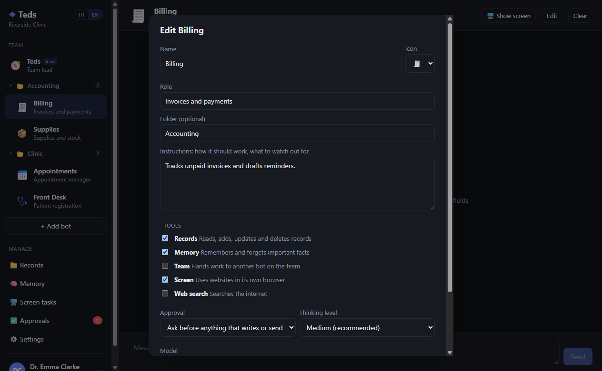
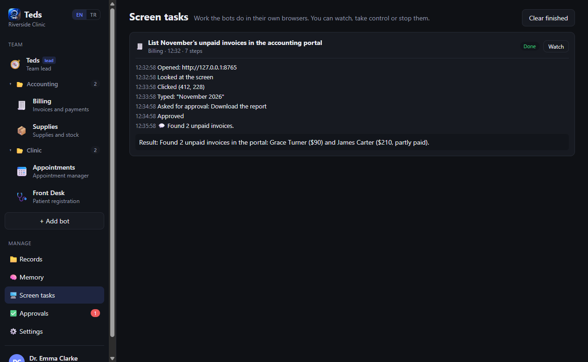
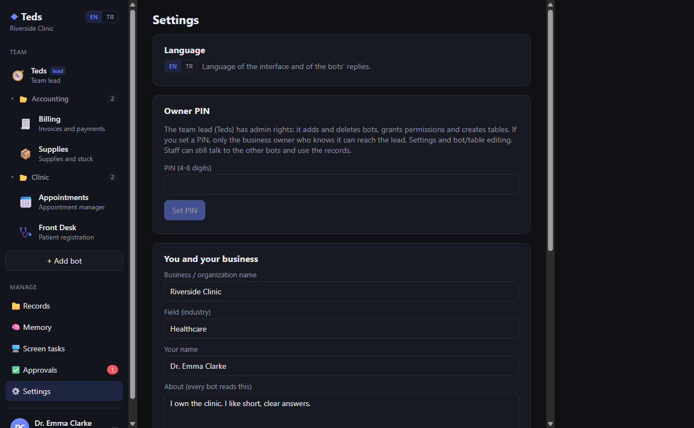
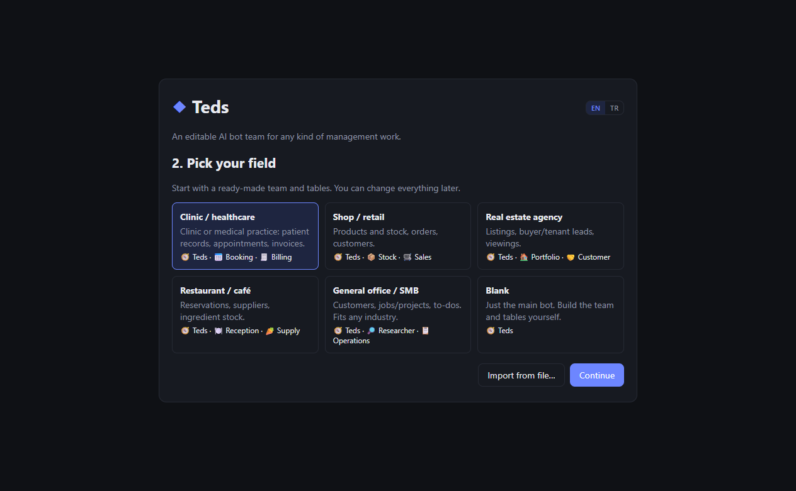
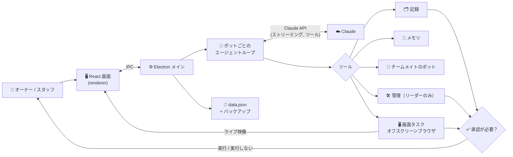

<div align="center">

# ◆ Teds

[English](README.md) | [Deutsch](README.de.md) | [Türkçe](README.tr.md) | [简体中文](README.zh-CN.md) | **日本語**

### あらゆる管理業務に使える、自由に編集できる AI ボットチーム

**AI ボットのチームに記録とルールとブラウザを渡せば、面倒な作業はボットが片付け、大事なことだけをあなたが承認します。**

[](LICENSE)
[](#installation)
[](#architecture)
[](#how-the-bots-work)
[](#languages)
[](#project-status)

*チームリーダーのボットと専門ボットが記録と共有メモリを共有し、互いに仕事を引き継ぎ、自分専用のブラウザで Web サイトを操作し、書き込み・送信・削除の前には必ずあなたの承認を求める Windows デスクトップアプリです。*



</div>

> [!IMPORTANT]
> 🌱 **これは Teds の初期の最初のバージョンです。** 動作し、試用には十分使えますが、まだ開発途中です。機能、データ形式、インターフェースは今後のバージョンで変わる可能性があります。フィードバックや不具合の報告を歓迎します。

> [!NOTE]
> アプリの画面は現在**英語**と**トルコ語**に対応しています。スクリーンショットは英語版の画面です。

---

## 📑 目次

- [なぜ Teds？](#why)
- [誰のためのもの？](#audience)
- [スクリーンショット](#screenshots)
- [機能](#features)
- [ボットの仕組み](#how-the-bots-work)
- [アーキテクチャ](#architecture)
- [インストール](#installation)
- [使い方](#usage)
- [言語](#languages)
- [セキュリティとプライバシー](#security)
- [プロジェクト構成](#structure)
- [制限事項](#limitations)
- [ロードマップ](#roadmap)
- [プロジェクトの状況](#project-status)
- [ライセンスと免責事項](#license)

---

<a id="why"></a>
## 🔍 なぜ Teds？

小さな会社やクリニック、オフィスを運営していると、繰り返しの作業がたくさんあります。表から情報を探す、予約を入れたり変更したりする、未払いの請求書を追いかける、Web ポータルから数字を書き写す。ひとつのチャットボットはこうした仕事について話すことはできても、記録を管理したり、ルールに従ったり、安心して自分で変更を任せたりすることはできません。

Teds はそれを**チーム**に変えます。

- あなたの要望を理解し、適切な専門ボットに振り分ける**チームリーダー**ボット。
- それぞれ独自の役割・指示・ツールを持つ**専門ボット**（予約、請求、在庫、リサーチ……）。
- **共有の記録**（あなたが定義する表）、事実やルールを保存する**共有メモリ**、そして書き込み・送信・削除の前の**承認ステップ**。
- **ボットごとに本物のブラウザ**があり、ボットが Web ポータルで作業している間、あなたは見守ったり、操作を代わったり、止めたりできます。

チームの内容は何ひとつ固定されていません。テンプレート（医療、小売、不動産、飲食店、一般オフィス、空白）から始めて、ボットの名前を変えたり、指示を書き直したり、表や項目を追加したり、それをチームリーダーに任せたりできます。

---

<a id="audience"></a>
## 👥 誰のためのもの？

| 対象 | 主な使い方 |
| --- | --- |
| **クリニック・診療所** | 患者登録、重複チェック付きの予約、請求書のフォローアップ。 |
| **店舗・小規模小売** | 在庫数と在庫不足のアラート、注文、顧客への返信。 |
| **不動産会社** | 物件、見込み客とその条件、内見のスケジュール。 |
| **レストラン・カフェ** | 予約、食材の在庫、仕入れ先への発注書の下書き。 |
| **あらゆるオフィス・中小企業** | 顧客、案件とやることリスト、出典付きの Web リサーチ。 |
| **開発者・ものづくり好き** | Claude API を使ったマルチエージェント型デスクトップアプリの読みやすい実例：ツール使用、承認、コンピューター操作（computer use）、コンテキスト管理。 |

---

<a id="screenshots"></a>
## 🖼️ スクリーンショット

> スクリーンショットでは、架空の患者と請求書を使った**架空のデモクリニック**を使用しています。実際のデータは含まれていません。

| チームリーダーが依頼して報告 | 変更前の承認 |
| :---: | :---: |
|  |  |
| **自分で定義する記録** | **ボット専用のブラウザをライブ表示** |
|  |  |
| **ボットの編集** | **画面タスクの履歴** |
|  |  |
| **設定、言語、オーナー PIN** | **初回起動時のテンプレート** |
|  |  |

---

<a id="features"></a>
## 🚀 機能

### チーム

| 項目 | できること |
| --- | --- |
| 🧭 **チームリーダー** | 1 体のボットがチームを率います。簡単な仕事は自分でこなし、専門的な仕事はチームメイトに任せ、最後に結果をまとめます。 |
| 🛠️ **管理者としてのリーダー** | リーダーはボットの作成・編集・削除、ツールや承認モードの付与、表や項目の作成・変更ができます。権限の拡大と削除は必ずオーナーの承認が必要です。 |
| 🔒 **オーナー専用のリーダー** | オーナー PIN を設定すると、リーダーとの会話、設定画面、チームや表の構成変更はオーナーだけが行えます。ほかのボットはリーダーに連絡できません。30 分操作がないと再びロックされます。 |
| 🤝 **仕事の依頼** | *チーム*ツールを持つボットは、チームメイトに助けを求めて返事を待つことができます。 |
| 📁 **フォルダー** | サイドバーでボットをまとめられます。ボットを別のボットの上にドラッグするとフォルダーができ、フォルダーを右クリックすると名前を変更できます。 |
| 🧩 **テンプレート** | 医療、小売、不動産、飲食店、一般オフィス、空白。チームと表を JSON に書き出し、別の環境に読み込めます（記録とチャットは書き出されません）。 |

### 作業と安全性

| 項目 | できること |
| --- | --- |
| 🗂️ **記録** | あなたが設計する表（テキスト、長文、数値、日付、選択肢の項目）。ボットが検索・追加・更新・削除し、手動で編集することもできます。 |
| ✅ **承認** | 各ボットは、書き込みや送信の前に毎回確認するか、自分の判断で実行するかを選べます。削除と支払いはどちらのモードでも必ず確認されます。却下するときに、代わりにどうすべきかをメモでボットに伝えられます。 |
| 🧠 **共有メモリ** | ボットは長く使う事実やルール（「クラーク先生は火曜の午後は診察しない」）を保存し、すべてのボットがそれを読みます。あなたも編集できます。 |
| 🖥️ **画面操作** | *画面*ツールを持つボットは専用のブラウザウィンドウで作業します。ページを開き、見て、クリックし、入力し、スクロールします。チャットの横のパネルでライブに見守り、操作を代わる、操作を戻す、止めることができます。 |
| 🌐 **Web 検索** | *Web 検索*ツールを持つボットはインターネットを検索できます。 |
| 💾 **安全な保存** | データはアトミックに保存され、自動バックアップ（最短 10 分ごと、最新 30 件を保持）と、破損したデータファイルからの復旧に対応しています。 |

---

<a id="how-the-bots-work"></a>
## 🧠 ボットの仕組み

各ボットは独自のシステムプロンプトを持つ Claude のエージェントループです。プロンプトは次の内容から組み立てられます。

- ボットの役割とあなたからの指示
- チームのメンバー
- 表とその項目
- 共有メモリ
- 今日の日付と承認ルール

ボットが使えるツールは、そのボットに有効にしたツールグループによって決まります。

| ツールグループ | ツール |
| --- | --- |
| 記録 | 表の一覧、記録の検索・追加・更新・削除 |
| メモリ | 覚える、忘れる |
| チーム | チームメイトに質問する（リーダーには質問しない） |
| 画面 | Claude の computer use ツールを使い、ボット専用ブラウザで画面タスクを実行 |
| Web 検索 | Claude のサーバー側 Web 検索 |
| *（リーダーのみ）* | ボットの一覧・作成・更新・削除、表の作成・更新・削除 |

内部では、Teds は公式の Anthropic TypeScript SDK を次の機能とともに使っています。

- ストリーミング
- ボットごとに思考の強さを設定できるアダプティブ思考
- プロンプトキャッシュ
- 長い画面タスクで古いツール結果を消すコンテキスト編集

デフォルトのモデルは Claude Opus 5.5 です。設定画面またはボットごとに変更できます（日常的な用途には、より安価な Sonnet 5.5 もおすすめです）。

---

<a id="architecture"></a>
## 🏗️ アーキテクチャ



- **メインプロセス**（`src/main`）：状態と保存、エージェントループ、ツール、承認、オーナーロック、ボットのブラウザウィンドウ。
- **レンダラー**（`src/renderer`）：React の画面。小さな型付き IPC ブリッジを通してのみメインプロセスとやり取りします。
- **ボットの画面**は非表示のオフスクリーンブラウザウィンドウです。その映像はライブパネルに送られ、パネル上でのクリックやキー入力はボット側に送り返されます。

---

<a id="installation"></a>
## 📦 インストール

**必要なもの**

- Windows 10 または 11
- [Node.js](https://nodejs.org) 22 以降
- [platform.claude.com](https://platform.claude.com/settings/keys) で取得した Claude API キー（利用料金は Anthropic から請求されます）

**かんたんな方法：** プロジェクトフォルダーの **`Teds.cmd`** をダブルクリックします。初回は依存関係をインストールし、その後は起動するたびにアプリをビルドして開きます。

**コマンドラインから**

```bash
npm install
npm run build
npm start
```

| スクリプト | 内容 |
| --- | --- |
| `npm run dev` | ホットリロード付きの開発モード |
| `npm run build` | アプリを `out/` にビルド |
| `npm start` | ビルド済みのアプリを開く |
| `npm run typecheck` | プロジェクト全体の型チェック |
| `npm run dist` | `dist/` に Windows インストーラーを作成（未テスト） |

---

<a id="usage"></a>
## 🧭 使い方

1. **初回起動：** 言語（EN / TR）を選び、Claude API キーを貼り付け、テンプレートを選んで、あなたの仕事について Teds に少し教えます。
2. **ボットと話す：** サイドバーでボットを選び、仕事を頼みます。例：*「サラ・ミッチェルさんを明日 10:30 にクラーク先生で予約して」*。ツールの手順はチャット内に小さなメモとして表示されます。
3. **承認する：** ボットが書き込み・送信・削除をしようとすると、チャットと **Approvals**（承認）ページに **Do it / Don't**（実行 / 実行しない）カードが表示されます。
4. **チームを整える：** ボットの **Edit**（編集）、**+ Add bot**（ボットを追加）、**Records**（記録）ページを使うか、チームリーダーに頼むだけでも OK です（*「備品の表と、それを使える在庫ボットを作って」*）。
5. **ロックする：** **Settings**（設定）でオーナー PIN を設定します。スタッフはほかのボットで作業を続けられ、リーダーと設定はあなただけのものになります。
6. **画面タスクを見る：** *画面*ツールを持つボットに Web サイトでの作業を頼みます。チャットの横にボットのブラウザが開くので、**Take control**（操作を代わる）で自分でクリックしたり、**Stop**（停止）で止めたりできます。

データは `%APPDATA%\Teds`（`data.json`、`backups\`、暗号化された `api-key.bin`）に保存されます。

---

<a id="languages"></a>
## 🌍 言語

Teds は**英語**（デフォルト）と**トルコ語**に対応しています。サイドバー、初回起動画面、または設定画面の **EN | TR** スイッチで切り替えます。

切り替えで変わるもの：

- インターフェース全体
- ボットが返答する言語
- ボットがチャットに残すメモ
- 適用するテンプレート

あなたが自分で作った内容（ボット名、記録、メモリ、過去のチャット）は書いたときのまま残ります。

ソース中の文字列、プロンプト、コードコメントはすべて英語です。トルコ語の翻訳は [`src/shared/i18n.tr.ts`](src/shared/i18n.tr.ts) にあり、翻訳のない部分は英語で表示されます。新しい言語を追加するには、辞書ファイルをもうひとつ追加するだけです。

---

<a id="security"></a>
## 🛡️ セキュリティとプライバシー

- **API キー**は Windows DPAPI（Electron `safeStorage`）で暗号化され、画面に再表示されることはありません。
- **オーナー PIN** は scrypt ハッシュとしてのみ保存されます。
- **承認**はモデルではなくアプリが強制します。削除、支払い、権限の変更には、必ず人間の「実行」が必要です。
- **Web コンテンツはデータとして扱われます。** ボットには Web ページや記録の中にある指示に従わないよう伝えてあり、画面ツールは `http`/`https` のアドレスしか開きません。これでプロンプトインジェクションのリスクは下がりますが、なくなるわけではありません。Web を使うボットでは承認をオンのままにしてください。
- **画面は Node から分離されています**（`contextIsolation`、`nodeIntegration` なし）。リンクは普段使っているブラウザで開きます。
- **パソコンの外に送られるもの：** ボットが作業に必要とするメッセージ、記録、メモリ、スクリーンショットが Claude API に送信されます。それ以外はどこにも送信されません。

> [!WARNING]
> 個人情報や健康情報を扱う場合は、実際のデータを Teds に入れる前に、適用される法律（GDPR や KVKK など）上の義務を確認してください。

---

<a id="structure"></a>
## 🗂️ プロジェクト構成

| パス | 内容 |
| --- | --- |
| `src/shared/types.ts` | 共有データ型のすべて |
| `src/shared/templates.ts` | 業種別テンプレート（新しいものはここに追加） |
| `src/shared/i18n.ts`, `i18n.tr.ts` | 言語切り替えとトルコ語辞書 |
| `src/main/index.ts` | アプリのエントリー、IPC ハンドラー、オーナー専用チェック |
| `src/main/store.ts` | 状態、保存、バックアップ、オーナー PIN、暗号化 API キー |
| `src/main/claude.ts` | Claude エージェントループ：ストリーミング、ツール呼び出し、エラー処理 |
| `src/main/agent.ts` | ボットのシステムプロンプトとツール（記録、メモリ、チーム、画面、Web） |
| `src/main/admin.ts` | チームリーダーの管理ツール |
| `src/main/approvals.ts` | 承認リクエストと回答 |
| `src/main/screen.ts` | ボットのオフスクリーンブラウザウィンドウと入力 |
| `src/main/screenTask.ts` | 画面タスクのループ（computer use） |
| `src/renderer/src/` | React の画面 |
| `docs/screenshots/` | README 用スクリーンショット |
| `Teds.cmd` | Windows 用ワンクリック起動ファイル |

---

<a id="limitations"></a>
## ⚠️ 制限事項

- **Windows のみ、1 台のパソコンのみ。** データはローカルファイルです。複数の人が別々の端末から同時に作業することにはまだ対応していません。
- **インストーラー（`npm run dist`）は未テストです。** 当面は `Teds.cmd` か `npm start` を使ってください。
- **AI は間違えることがあります。** ボットが依頼や Web ページを読み違えることがあります。承認が役に立ちますが、重要な結果は確認してください。
- **費用**はモデルと利用量によって変わります。画面タスクはスクリーンショットを送るため、チャットより高くなります。
- **自動テストはまだありません。**

---

<a id="roadmap"></a>
## 🧭 ロードマップ

今後のバージョンに向けたアイデアです。どれもまだ約束されたものではありません。

- ブラウザからの複数ユーザーアクセスと、会社の Web サイトから届く依頼への対応
- データベース（SQLite/PostgreSQL）と、ボットによる SQL テーブル管理
- 音声入力と音声での返答
- テスト済みの Windows インストーラーと自動アップデート
- 自動テスト

---

<a id="project-status"></a>
## 🌱 プロジェクトの状況

これは出発点として公開した Teds の**最初の公開バージョン**です。今後のバージョンでは、新機能、異なるデータ形式、作り直したインターフェースなどの変更がありえます。これをもとに開発する場合は、特定のコミットに固定してください。

---

<a id="license"></a>
## 📄 ライセンスと免責事項

[MIT ライセンス](LICENSE)で公開しています。

Teds は医療機器ではなく、医療・法律・金融に関する助言は行いません。ボットの作業内容の確認と、アプリに入力するデータについては利用者の責任となります。

Teds は、macOS 向けの AI ボットチームである [Bops](https://github.com/OrgoAI/bops) のアイデアに着想を得ています。Windows 向けにゼロから書かれており、Bops のコードは含まれていません。
