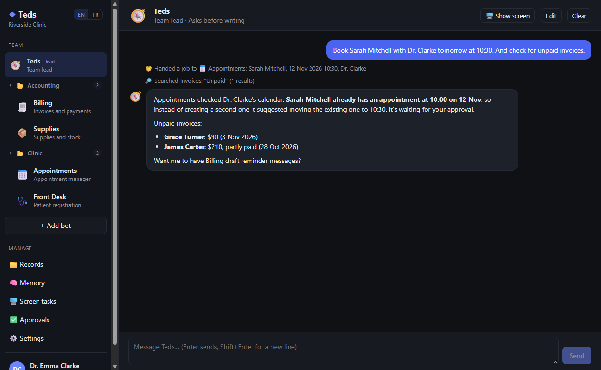
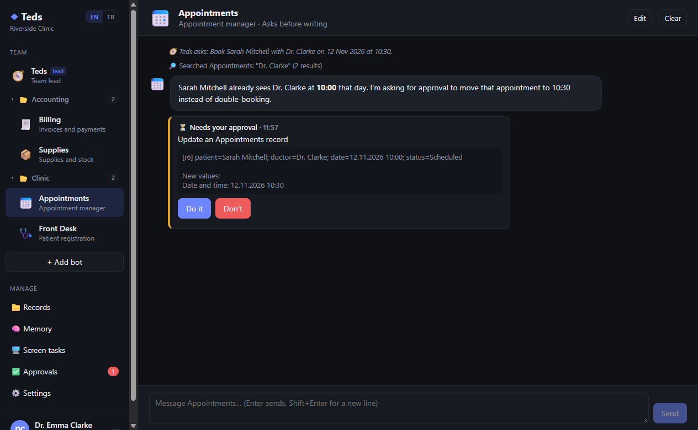
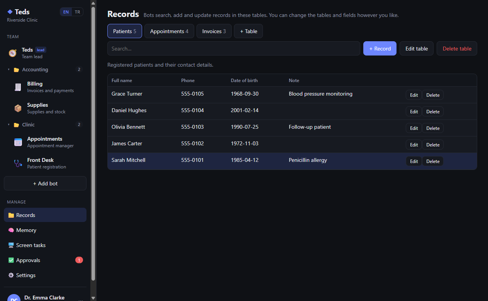
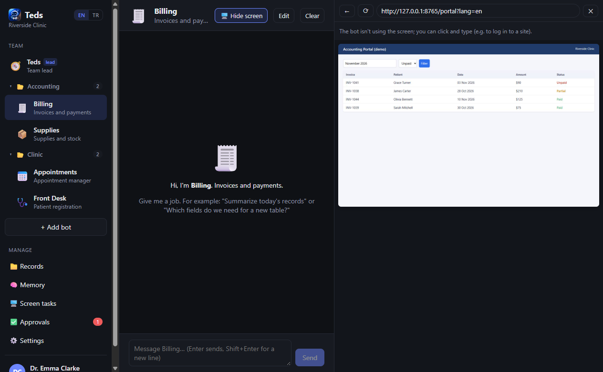
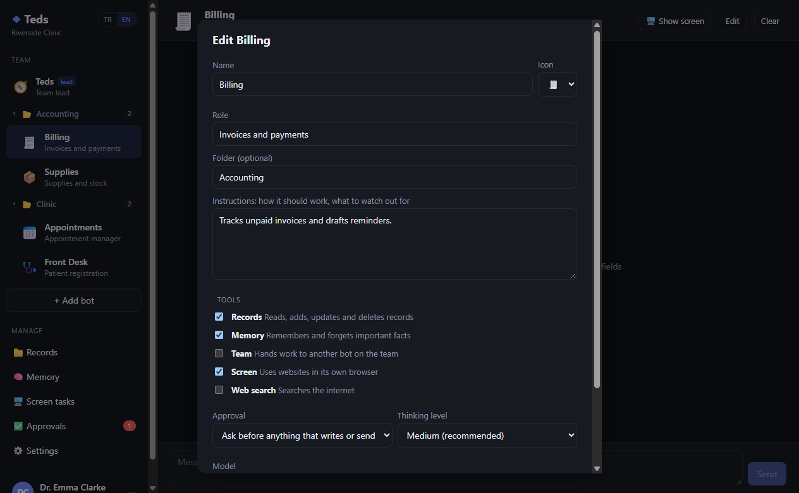
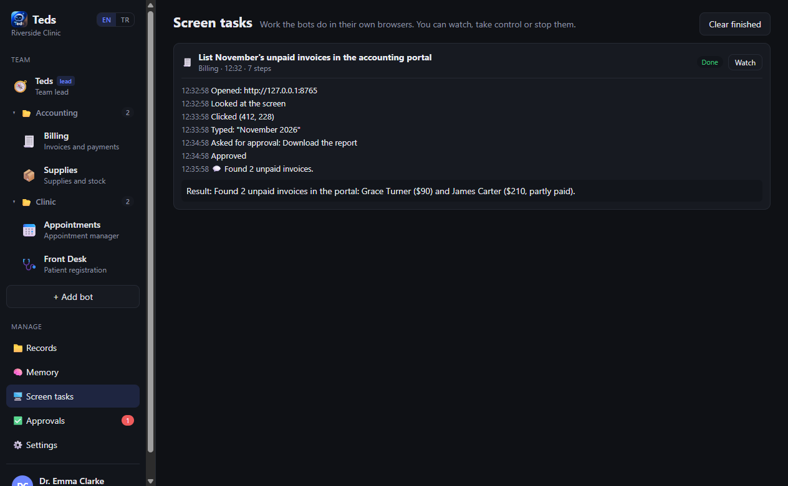
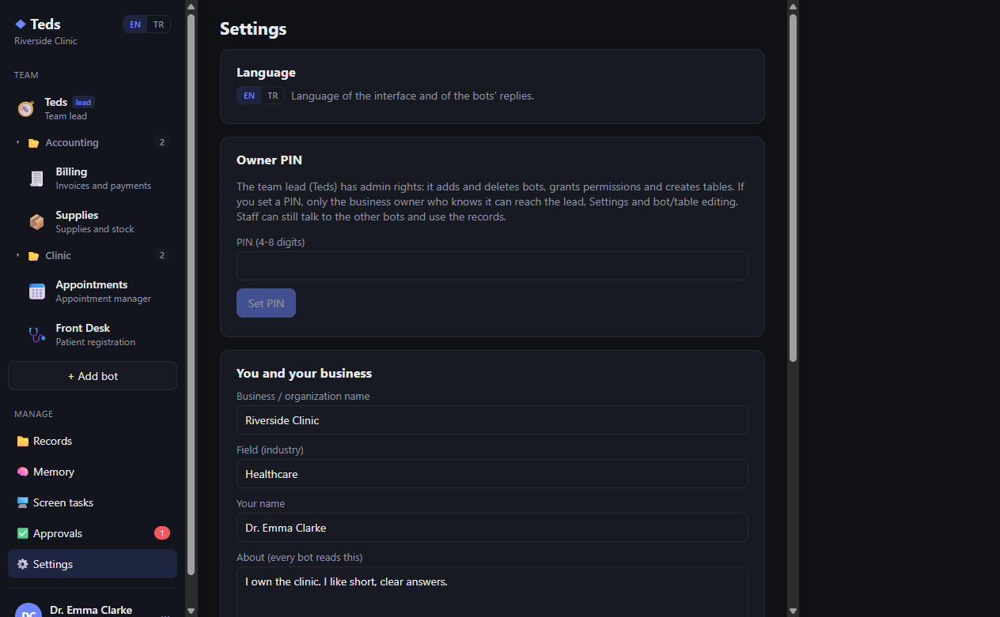
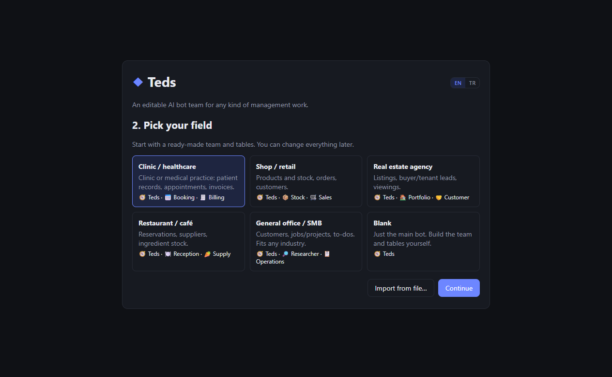
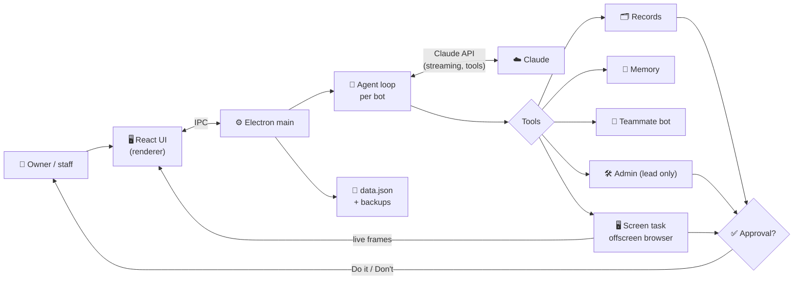

<div align="center">

# ◆ Teds

**English** | [Deutsch](README.de.md) | [Türkçe](README.tr.md) | [简体中文](README.zh-CN.md) | [日本語](README.ja.md)

### An editable AI bot team for any kind of management work

**Give a team of AI bots your records, your rules and a browser, and let them do the busywork while you approve what matters.**

[](LICENSE)
[](#installation)
[](#architecture)
[](#how-the-bots-work)
[](#languages)
[](#project-status)

*A Windows desktop app where a team lead bot and specialist bots share your records and memory, hand work to each other, use websites in their own browser, and ask for your approval before anything that writes, sends or deletes.*



</div>

> [!IMPORTANT]
> 🌱 **This is an early, first version of Teds.** It works and is usable for trials, but it is still evolving: features, data formats and the interface may change in later versions. Feedback and issue reports are very welcome.

---

## 📑 Contents

- [Why Teds?](#why)
- [Who is it for?](#audience)
- [Screenshots](#screenshots)
- [Features](#features)
- [How the bots work](#how-the-bots-work)
- [Architecture](#architecture)
- [Installation](#installation)
- [Usage](#usage)
- [Languages](#languages)
- [Security and privacy](#security)
- [Project structure](#structure)
- [Limitations](#limitations)
- [Roadmap](#roadmap)
- [Project status](#project-status)
- [License and disclaimer](#license)

---

<a id="why"></a>
## 🔍 Why Teds?

Running a small business, clinic or office means a lot of repetitive work: looking things up in tables, booking and moving appointments, chasing unpaid invoices, copying numbers out of web portals. A single chatbot can talk about that work, but it can't keep your records, follow your rules, or be trusted to change things on its own.

Teds turns that into a **team**:

- A **team lead** bot that understands what you want and routes it to the right specialist.
- **Specialist bots** (appointments, billing, stock, research…) each with their own role, instructions and tools.
- **Shared records** (tables you define), a **shared memory** of facts and rules, and an **approval step** before anything that writes, sends or deletes.
- A **real browser per bot**, so a bot can work in a web portal while you watch, take control, or stop it.

Nothing about the team is hard-coded. Start from a template (healthcare, retail, real estate, restaurant, general office or blank), then rename bots, rewrite their instructions, add tables and fields, or let the team lead do it for you.

---

<a id="audience"></a>
## 👥 Who is it for?

| Audience | Typical use |
| --- | --- |
| **Clinics and practices** | Patient registration, appointment booking with clash checks, invoice follow-up. |
| **Shops and small retailers** | Stock levels and critical-stock alerts, orders, customer replies. |
| **Real estate agencies** | Listings, leads and their criteria, viewing schedules. |
| **Restaurants and cafés** | Reservations, ingredient stock, supplier order drafts. |
| **Any office or SMB** | Customers, jobs and to-dos, web research with sources. |
| **Builders and tinkerers** | A readable reference for a multi-agent desktop app on the Claude API: tool use, approvals, computer use and context management. |

---

<a id="screenshots"></a>
## 🖼️ Screenshots

> The screenshots use a **fictional demo clinic** with made-up patients and invoices. No real data is shown.

| Team lead delegates and reports | Approval before a change |
| :---: | :---: |
|  |  |
| **Records you define** | **A bot's own browser, live** |
|  |  |
| **Editing a bot** | **Screen task history** |
|  |  |
| **Settings, language and owner PIN** | **First-run templates** |
|  |  |

---

<a id="features"></a>
## 🚀 Features

### The team

| Area | What it does |
| --- | --- |
| 🧭 **Team lead** | One bot leads the team. It does simple work itself and hands specialist work to teammates, then summarizes the result. |
| 🛠️ **Admin lead** | The lead can create, edit and delete bots, grant tools and approval modes, and create or change tables and fields. Widening permissions and deleting always go to the owner for approval. |
| 🔒 **Owner-only lead** | With an owner PIN set, only the business owner can talk to the lead, open Settings or change the team and table structure. Other bots can't reach the lead. The lock closes again after 30 minutes of inactivity. |
| 🤝 **Delegation** | Bots with the *Team* tool can ask a teammate for help and wait for the answer. |
| 📁 **Folders** | Group bots in the sidebar: drag one bot onto another to create a folder, right-click a folder to rename it. |
| 🧩 **Templates** | Healthcare, retail, real estate, restaurant, general office or blank. Export your team and tables to JSON and import them elsewhere (records and chats are not exported). |

### Work and safety

| Area | What it does |
| --- | --- |
| 🗂️ **Records** | Tables you design (text, long text, number, date, choice fields). Bots search, add, update and delete; you can edit by hand too. |
| ✅ **Approvals** | Each bot either asks before anything that writes or sends, or acts on its own. Deletes and payments always ask, whichever mode is set. You can reject with a note telling the bot what to do instead. |
| 🧠 **Shared memory** | Bots save lasting facts and rules ("Dr. Clarke doesn't see patients on Tuesday afternoons"); every bot reads them, and you can edit them. |
| 🖥️ **Screen control** | A bot with the *Screen* tool works in its own browser window: it opens pages, looks, clicks, types and scrolls. You watch it live in a panel next to the chat, take control, hand control back, or stop it. |
| 🌐 **Web search** | Bots with the *Web search* tool can search the internet. |
| 💾 **Safe storage** | Data is saved atomically, with automatic backups (at most every 10 minutes, last 30 kept) and recovery from a damaged data file. |

---

<a id="how-the-bots-work"></a>
## 🧠 How the bots work

Each bot is a Claude agent loop with its own system prompt, built from:

- its role and your instructions for it,
- who is on the team,
- the tables and their fields,
- the shared memory,
- today's date and the approval rules.

The tools a bot gets depend on the tool groups you enable for it:

| Tool group | Tools |
| --- | --- |
| Records | list tables, find, add, update and delete records |
| Memory | remember, forget |
| Team | ask a teammate (never the lead) |
| Screen | run a screen task in the bot's own browser using Claude's computer-use toolset |
| Web search | Claude's server-side web search |
| *(lead only)* | list, create, update and delete bots; create, update and delete tables |

Under the hood Teds uses the official Anthropic TypeScript SDK with:

- streaming,
- adaptive thinking with a per-bot effort level,
- prompt caching,
- context editing that clears old tool results in long screen tasks.

The default model is Claude Opus 5.5. You can change it in Settings or per bot (Sonnet 5.5 is a good, cheaper everyday choice).

---

<a id="architecture"></a>
## 🏗️ Architecture



- **Main process** (`src/main`): state and storage, the agent loop, tools, approvals, the owner lock and the bots' browser windows.
- **Renderer** (`src/renderer`): the React interface. It only talks to the main process through a small, typed IPC bridge.
- **Bot screens** are hidden, offscreen browser windows. Their frames are streamed to the live panel, and your clicks and keys in the panel are sent back to them.

---

<a id="installation"></a>
## 📦 Installation

**Requirements**

- Windows 10 or 11
- [Node.js](https://nodejs.org) 22 or newer
- A Claude API key from [platform.claude.com](https://platform.claude.com/settings/keys) (usage is billed by Anthropic)

**The easy way:** double-click **`Teds.cmd`** in the project folder. The first run installs the dependencies, then every run builds the app and opens it.

**From the command line**

```bash
npm install
npm run build
npm start
```

| Script | What it does |
| --- | --- |
| `npm run dev` | Development mode with hot reload |
| `npm run build` | Build the app into `out/` |
| `npm start` | Open the built app |
| `npm run typecheck` | Type-check the whole project |
| `npm run dist` | Build a Windows installer into `dist/` (not tested yet) |

---

<a id="usage"></a>
## 🧭 Usage

1. **First run:** choose a language (EN / TR), paste your Claude API key, pick a template and tell Teds a little about your business.
2. **Talk to a bot:** pick a bot in the sidebar and give it a job, for example *"Book Sarah Mitchell with Dr. Clarke tomorrow at 10:30"*. Tool steps show up in the chat as small notes.
3. **Approve:** when a bot wants to write, send or delete, a **Do it / Don't** card appears in the chat and on the **Approvals** page.
4. **Shape the team:** use **Edit** on a bot, **+ Add bot**, the **Records** page, or simply ask the team lead (*"Create a Supplies table and a Stock bot that can use it"*).
5. **Lock it:** set an owner PIN in **Settings**. Staff can keep working with the other bots; the lead and the settings stay with you.
6. **Watch a screen task:** give a bot with the *Screen* tool a job on a website. Its browser opens next to the chat; use **Take control** to click yourself, or **Stop**.

Your data lives in `%APPDATA%\Teds` (`data.json`, `backups\`, and the encrypted `api-key.bin`).

---

<a id="languages"></a>
## 🌍 Languages

Teds ships in **English** (the default) and **Turkish**. Use the **EN | TR** switch in the sidebar, on the first-run screen or in Settings.

The switch changes:

- the whole interface,
- the language the bots reply in,
- the notes they leave in the chat,
- the templates you apply.

Content you created yourself (bot names, records, memory, old chats) stays as you wrote it.

All source strings, prompts and code comments are in English. The Turkish translation lives in [`src/shared/i18n.tr.ts`](src/shared/i18n.tr.ts); anything without a translation falls back to English. Adding another language means adding one more dictionary file.

---

<a id="security"></a>
## 🛡️ Security and privacy

- **The API key** is encrypted with Windows DPAPI (Electron `safeStorage`) and never shown again in the interface.
- **The owner PIN** is stored only as an scrypt hash.
- **Approvals** are enforced by the app, not by the model. Deletes, payments and permission changes always need a human "Do it".
- **Web content is treated as data.** Bots are told not to follow instructions found on web pages or in records, and the screen tools only open `http`/`https` addresses. This reduces prompt-injection risk but cannot remove it, so keep approvals on for bots that use the web.
- **The interface is sandboxed** from Node (`contextIsolation`, no `nodeIntegration`). Links open in your normal browser.
- **What leaves your computer:** the messages, records, memory and screenshots a bot needs for a task are sent to the Claude API. Nothing else is sent anywhere.

> [!WARNING]
> If you handle personal or health data, check your obligations under the laws that apply to you (for example GDPR or KVKK) before you put real data into Teds.

---

<a id="structure"></a>
## 🗂️ Project structure

| Path | Contents |
| --- | --- |
| `src/shared/types.ts` | All shared data types |
| `src/shared/templates.ts` | Industry templates (add a new one here) |
| `src/shared/i18n.ts`, `i18n.tr.ts` | Language switch and the Turkish dictionary |
| `src/main/index.ts` | App entry, IPC handlers, owner-only checks |
| `src/main/store.ts` | State, saving, backups, owner PIN, encrypted API key |
| `src/main/claude.ts` | Claude agent loop: streaming, tool calls, errors |
| `src/main/agent.ts` | Bot system prompts and tools (records, memory, team, screen, web) |
| `src/main/admin.ts` | The team lead's admin tools |
| `src/main/approvals.ts` | Approval requests and answers |
| `src/main/screen.ts` | The bots' offscreen browser windows and input |
| `src/main/screenTask.ts` | Screen task loop (computer use) |
| `src/renderer/src/` | React interface |
| `docs/screenshots/` | README screenshots |
| `Teds.cmd` | One-click launcher for Windows |

---

<a id="limitations"></a>
## ⚠️ Limitations

- **Windows only, one computer.** Data is a local file. Several people working at once from different devices is not supported yet.
- **The installer (`npm run dist`) has not been tested.** Use `Teds.cmd` or `npm start` for now.
- **AI can be wrong.** Bots can misread a request or a web page. Approvals help, but check important results.
- **Costs** depend on the model and on usage. Screen tasks send screenshots and cost more than chat.
- **No automated test suite yet.**

---

<a id="roadmap"></a>
## 🧭 Roadmap

Ideas for later versions. None of these are promised yet.

- Multi-user access from a browser, and requests coming in from a business website
- A database backend (SQLite/PostgreSQL) and SQL table management for bots
- Voice input and replies
- A tested Windows installer and auto-update
- Automated tests

---

<a id="project-status"></a>
## 🌱 Project status

This is the **first public version** of Teds, published as a starting point. Expect changes: new features, different data formats and a reworked interface are all possible in upcoming versions. If you build on it, pin to a specific commit.

---

<a id="license"></a>
## 📄 License and disclaimer

Released under the [MIT License](LICENSE).

Teds is not a medical device and does not give medical, legal or financial advice. You are responsible for checking what the bots do and for the data you put into the app.

Teds was inspired by the idea behind [Bops](https://github.com/OrgoAI/bops), a team of AI bots for macOS. It was written from scratch for Windows and does not contain Bops code.
