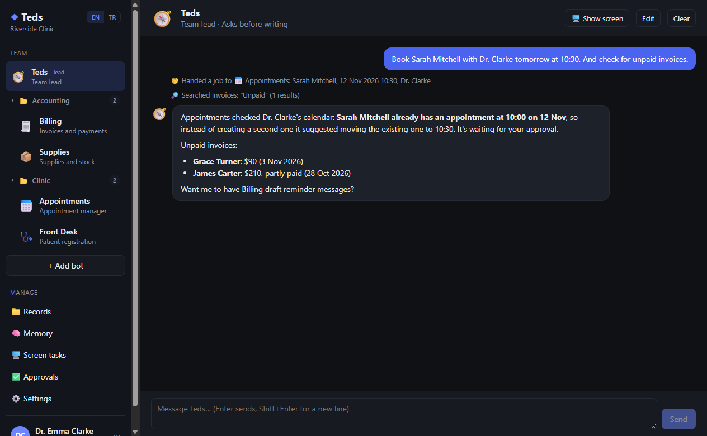
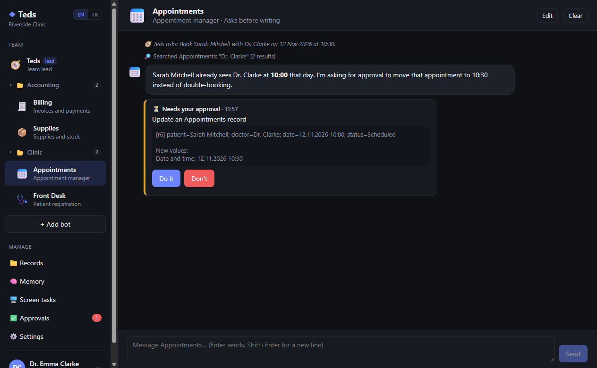
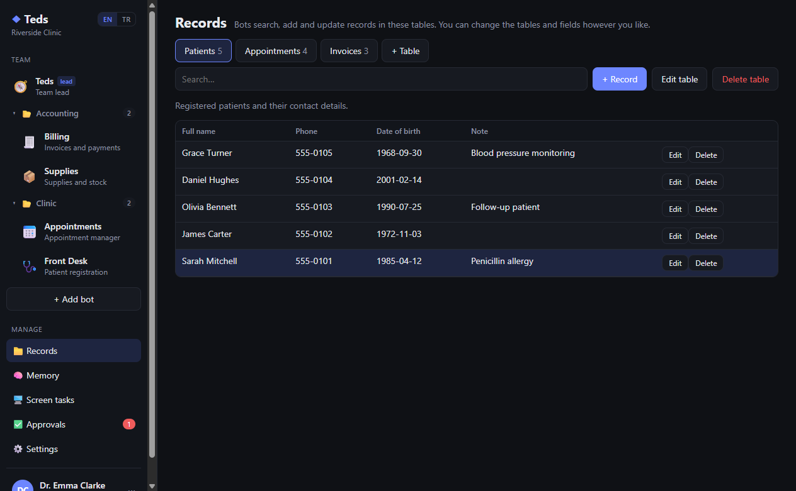
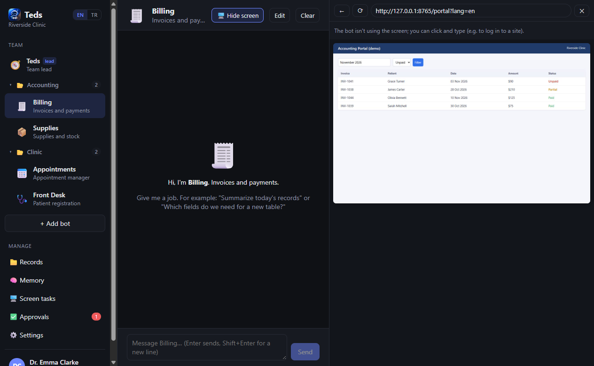
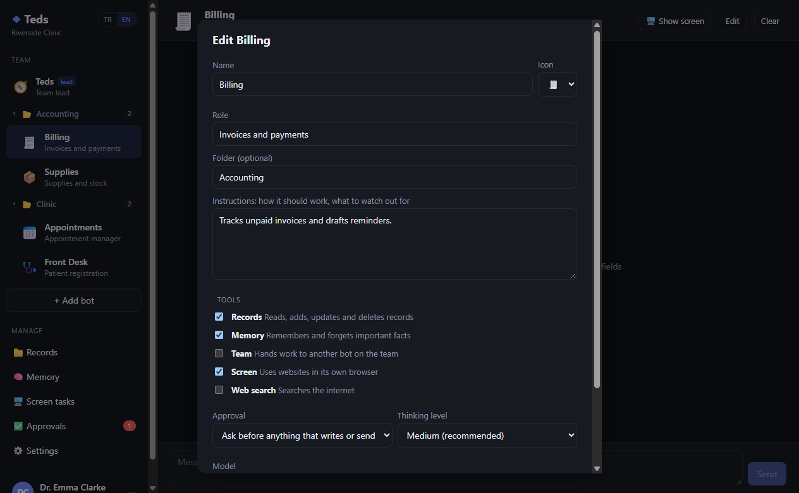
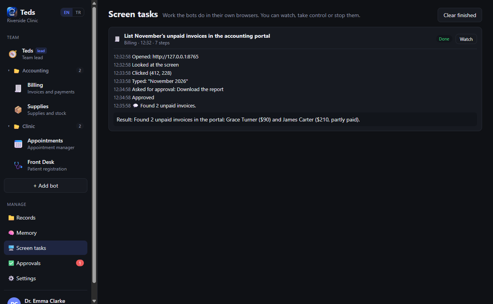
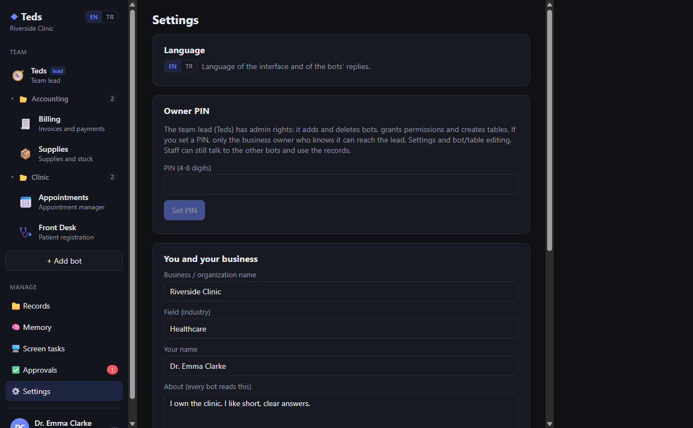
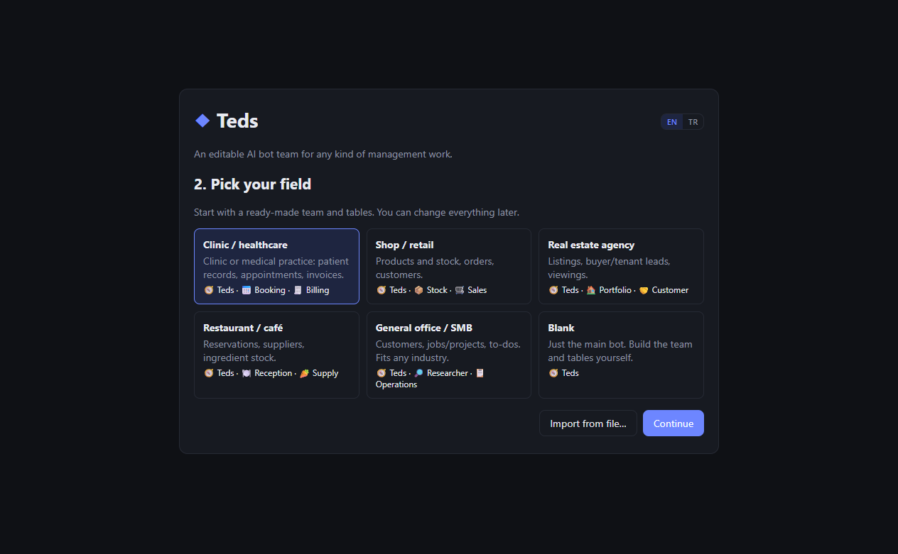
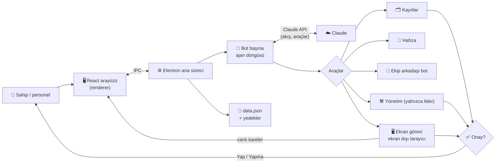

<div align="center">

# ◆ Teds

[English](README.md) | [Deutsch](README.de.md) | **Türkçe** | [简体中文](README.zh-CN.md) | [日本語](README.ja.md)

### Her türlü yönetim işi için düzenlenebilir bir yapay zekâ bot ekibi

**Bir yapay zekâ bot ekibine kayıtlarını, kurallarını ve bir tarayıcı ver; angarya işleri onlar yapsın, önemli olanları sen onayla.**

[](LICENSE)
[](#installation)
[](#architecture)
[](#how-the-bots-work)
[](#languages)
[](#project-status)

*Bir ekip lideri bot ile uzman botların kayıtlarını ve ortak hafızayı paylaştığı, işi birbirine devrettiği, web sitelerini kendi tarayıcılarında kullandığı ve yazma, gönderme ya da silme gibi her işten önce senden onay istediği bir Windows masaüstü uygulaması.*



</div>

> [!IMPORTANT]
> 🌱 **Bu, Teds'in erken, ilk sürümüdür.** Çalışıyor ve denemek için kullanılabilir, ama hâlâ gelişiyor: özellikler, veri biçimleri ve arayüz sonraki sürümlerde değişebilir. Geri bildirim ve hata bildirimleri memnuniyetle karşılanır.

> [!NOTE]
> Uygulama arayüzü **İngilizce** ve **Türkçe** olarak kullanılabilir. Ekran görüntüleri İngilizce arayüzü gösteriyor.

---

## 📑 İçindekiler

- [Neden Teds?](#why)
- [Kimler için?](#audience)
- [Ekran görüntüleri](#screenshots)
- [Özellikler](#features)
- [Botlar nasıl çalışır?](#how-the-bots-work)
- [Mimari](#architecture)
- [Kurulum](#installation)
- [Kullanım](#usage)
- [Diller](#languages)
- [Güvenlik ve gizlilik](#security)
- [Proje yapısı](#structure)
- [Sınırlamalar](#limitations)
- [Yol haritası](#roadmap)
- [Proje durumu](#project-status)
- [Lisans ve sorumluluk reddi](#license)

---

<a id="why"></a>
## 🔍 Neden Teds?

Küçük bir işletme, klinik ya da ofis yürütmek çok fazla tekrarlayan iş demek: tablolarda bir şeyler aramak, randevu almak ve kaydırmak, ödenmemiş faturaların peşine düşmek, web portallarından rakam kopyalamak. Tek bir sohbet botu bu işler hakkında konuşabilir, ama kayıtlarını tutamaz, kurallarına uyamaz ve kendi başına bir şeyi değiştirmesine güvenilemez.

Teds bunu bir **ekibe** dönüştürür:

- Ne istediğini anlayan ve işi doğru uzmana yönlendiren bir **ekip lideri** bot.
- Her birinin kendi rolü, talimatları ve araçları olan **uzman botlar** (randevu, fatura, stok, araştırma…).
- **Ortak kayıtlar** (senin tanımladığın tablolar), bilgi ve kurallar için **ortak bir hafıza** ve yazan, gönderen ya da silen her işten önce bir **onay adımı**.
- **Her bota gerçek bir tarayıcı**; böylece bot bir web portalında çalışırken sen izleyebilir, kontrolü alabilir ya da onu durdurabilirsin.

Ekipte hiçbir şey sabit kodlanmış değil. Bir şablonla başla (sağlık, perakende, emlak, restoran, genel ofis ya da boş), sonra botların adını değiştir, talimatlarını yeniden yaz, tablo ve alan ekle ya da bunları senin yerine ekip liderine yaptır.

---

<a id="audience"></a>
## 👥 Kimler için?

| Kitle | Tipik kullanım |
| --- | --- |
| **Klinikler ve muayenehaneler** | Hasta kaydı, çakışma kontrolüyle randevu, fatura takibi. |
| **Mağazalar ve küçük perakendeciler** | Stok seviyeleri ve kritik stok uyarıları, siparişler, müşteri yanıtları. |
| **Emlak ofisleri** | İlanlar, müşteri adayları ve kriterleri, gösterim programı. |
| **Restoranlar ve kafeler** | Rezervasyonlar, malzeme stoğu, tedarikçi sipariş taslakları. |
| **Her ofis ve KOBİ** | Müşteriler, işler ve yapılacaklar, kaynaklı web araştırması. |
| **Geliştiriciler ve meraklılar** | Claude API üzerinde çok ajanlı bir masaüstü uygulaması için okunabilir bir örnek: araç kullanımı, onaylar, bilgisayar kullanımı ve bağlam yönetimi. |

---

<a id="screenshots"></a>
## 🖼️ Ekran görüntüleri

> Ekran görüntülerinde uydurma hasta ve faturalarla **hayali bir demo klinik** kullanıldı. Gerçek veri gösterilmiyor.

| Ekip lideri devrediyor ve raporluyor | Değişiklikten önce onay |
| :---: | :---: |
|  |  |
| **Senin tanımladığın kayıtlar** | **Bir botun kendi tarayıcısı, canlı** |
|  |  |
| **Bir botu düzenlemek** | **Ekran görevi geçmişi** |
|  |  |
| **Ayarlar, dil ve sahip PIN'i** | **İlk açılış şablonları** |
|  |  |

---

<a id="features"></a>
## 🚀 Özellikler

### Ekip

| Alan | Ne yapar |
| --- | --- |
| 🧭 **Ekip lideri** | Ekibi bir bot yönetir. Basit işleri kendisi yapar, uzmanlık isteyen işleri ekip arkadaşlarına verir, sonra sonucu özetler. |
| 🛠️ **Yönetici lider** | Lider bot oluşturabilir, düzenleyebilir ve silebilir; araç ve onay modu verebilir; tablo ve alan oluşturup değiştirebilir. Yetkiyi genişletmek ve silmek her zaman sahibin onayına gider. |
| 🔒 **Yalnızca sahibe açık lider** | Sahip PIN'i ayarlıysa liderle konuşmak, Ayarlar'ı açmak ve ekip ile tablo yapısını değiştirmek yalnızca işletme sahibine açıktır. Diğer botlar lidere ulaşamaz. Kilit 30 dakika işlem yapılmayınca yeniden kapanır. |
| 🤝 **Görev devri** | *Ekip* aracına sahip botlar bir ekip arkadaşından yardım isteyip yanıtı bekleyebilir. |
| 📁 **Klasörler** | Kenar çubuğunda botları grupla: bir botu diğerinin üstüne sürükleyince klasör oluşur, klasöre sağ tıklayınca adı değiştirilir. |
| 🧩 **Şablonlar** | Sağlık, perakende, emlak, restoran, genel ofis ya da boş. Ekibini ve tablolarını JSON olarak dışa aktarıp başka yerde içe aktar (kayıtlar ve sohbetler aktarılmaz). |

### İş ve güvenlik

| Alan | Ne yapar |
| --- | --- |
| 🗂️ **Kayıtlar** | Senin tasarladığın tablolar (metin, uzun metin, sayı, tarih, seçim alanları). Botlar arar, ekler, günceller ve siler; sen de elle düzenleyebilirsin. |
| ✅ **Onaylar** | Her bot ya yazan veya gönderen her işten önce sorar ya da kendi başına hareket eder. Silme ve ödemeler, hangi mod seçili olursa olsun her zaman sorulur. Bota bunun yerine ne yapması gerektiğini söyleyen bir notla reddedebilirsin. |
| 🧠 **Ortak hafıza** | Botlar kalıcı bilgi ve kuralları kaydeder ("Dr. Clarke salı öğleden sonraları hasta bakmıyor"); her bot bunları okur, sen de düzenleyebilirsin. |
| 🖥️ **Ekran kontrolü** | *Ekran* aracına sahip bir bot kendi tarayıcı penceresinde çalışır: sayfa açar, bakar, tıklar, yazar ve kaydırır. Sohbetin yanındaki panelde onu canlı izler, kontrolü alır, geri verir ya da durdurursun. |
| 🌐 **Web araması** | *Web araması* aracına sahip botlar internette arama yapabilir. |
| 💾 **Güvenli kayıt** | Veriler atomik olarak kaydedilir; otomatik yedekler (en fazla 10 dakikada bir, son 30 tanesi saklanır) ve bozulmuş bir veri dosyasından kurtarma vardır. |

---

<a id="how-the-bots-work"></a>
## 🧠 Botlar nasıl çalışır?

Her bot, kendi sistem istemi olan bir Claude ajan döngüsüdür. Bu istem şunlardan oluşur:

- botun rolü ve ona verdiğin talimatlar,
- ekipte kimlerin olduğu,
- tablolar ve alanları,
- ortak hafıza,
- bugünün tarihi ve onay kuralları.

Bir botun aldığı araçlar, onun için açtığın araç gruplarına bağlıdır:

| Araç grubu | Araçlar |
| --- | --- |
| Kayıtlar | tabloları listele, kayıt bul, ekle, güncelle ve sil |
| Hafıza | hatırla, unut |
| Ekip | bir ekip arkadaşına sor (lidere asla) |
| Ekran | Claude'un bilgisayar kullanımı araçlarıyla botun kendi tarayıcısında ekran görevi çalıştır |
| Web araması | Claude'un sunucu tarafı web araması |
| *(yalnızca lider)* | botları listele, oluştur, güncelle ve sil; tablo oluştur, güncelle ve sil |

Arka planda Teds resmi Anthropic TypeScript SDK'sını şunlarla kullanır:

- akış (streaming),
- bot başına ayarlanabilen çaba düzeyiyle uyarlanabilir düşünme,
- istem önbellekleme (prompt caching),
- uzun ekran görevlerinde eski araç sonuçlarını temizleyen bağlam düzenleme.

Varsayılan model Claude Opus 5.5'tir. Ayarlar'dan ya da bot başına değiştirebilirsin (Sonnet 5.5 günlük kullanım için iyi ve daha ucuz bir seçimdir).

---

<a id="architecture"></a>
## 🏗️ Mimari



- **Ana süreç** (`src/main`): durum ve depolama, ajan döngüsü, araçlar, onaylar, sahip kilidi ve botların tarayıcı pencereleri.
- **Renderer** (`src/renderer`): React arayüzü. Ana süreçle yalnızca küçük, tipli bir IPC köprüsü üzerinden konuşur.
- **Bot ekranları** gizli, ekran dışı tarayıcı pencereleridir. Kareleri canlı panele aktarılır; paneldeki tıklamaların ve tuşların onlara geri gönderilir.

---

<a id="installation"></a>
## 📦 Kurulum

**Gereksinimler**

- Windows 10 ya da 11
- [Node.js](https://nodejs.org) 22 ya da daha yeni
- [platform.claude.com](https://platform.claude.com/settings/keys) adresinden bir Claude API anahtarı (kullanım Anthropic tarafından ücretlendirilir)

**Kolay yol:** proje klasöründeki **`Teds.cmd`** dosyasına çift tıkla. İlk çalıştırmada bağımlılıklar kurulur, sonra her açılışta uygulama derlenip açılır.

**Komut satırından**

```bash
npm install
npm run build
npm start
```

| Betik | Ne yapar |
| --- | --- |
| `npm run dev` | Anında yeniden yüklemeli geliştirme modu |
| `npm run build` | Uygulamayı `out/` klasörüne derler |
| `npm start` | Derlenmiş uygulamayı açar |
| `npm run typecheck` | Tüm projenin tip denetimini yapar |
| `npm run dist` | `dist/` klasörüne bir Windows kurulum dosyası oluşturur (henüz denenmedi) |

---

<a id="usage"></a>
## 🧭 Kullanım

1. **İlk açılış:** bir dil seç (EN / TR), Claude API anahtarını yapıştır, bir şablon seç ve Teds'e işletmenden biraz bahset.
2. **Bir botla konuş:** kenar çubuğundan bir bot seç ve ona bir iş ver, örneğin *"Sarah Mitchell'i yarın 10:30'da Dr. Clarke'a yaz"*. Araç adımları sohbette küçük notlar olarak görünür.
3. **Onayla:** bir bot yazmak, göndermek ya da silmek istediğinde sohbette ve **Onaylar** sayfasında bir **Yap / Yapma** kartı çıkar.
4. **Ekibi şekillendir:** bir botta **Düzenle**'yi, **+ Bot ekle**'yi, **Kayıtlar** sayfasını kullan ya da sadece ekip liderine söyle (*"Bir Malzemeler tablosu ve onu kullanabilen bir Stok botu oluştur"*).
5. **Kilitle:** **Ayarlar**'da bir sahip PIN'i belirle. Personel diğer botlarla çalışmaya devam eder; lider ve ayarlar sende kalır.
6. **Bir ekran görevini izle:** *Ekran* aracına sahip bir bota bir web sitesinde iş ver. Tarayıcısı sohbetin yanında açılır; kendin tıklamak için **Kontrolü al**'ı, durdurmak için **Durdur**'u kullan.

Verilerin `%APPDATA%\Teds` klasöründe durur (`data.json`, `backups\` ve şifreli `api-key.bin`).

---

<a id="languages"></a>
## 🌍 Diller

Teds **İngilizce** (varsayılan) ve **Türkçe** olarak gelir. Kenar çubuğundaki, ilk açılış ekranındaki ya da Ayarlar'daki **EN | TR** düğmesini kullan.

Düğme şunları değiştirir:

- arayüzün tamamını,
- botların yanıt verdiği dili,
- sohbette bıraktıkları notları,
- uyguladığın şablonları.

Kendi oluşturduğun içerik (bot adları, kayıtlar, hafıza, eski sohbetler) yazdığın gibi kalır.

Tüm kaynak metinler, istemler ve kod yorumları İngilizcedir. Türkçe çeviri [`src/shared/i18n.tr.ts`](src/shared/i18n.tr.ts) dosyasındadır; çevirisi olmayan her şey İngilizceye düşer. Yeni bir dil eklemek, bir sözlük dosyası daha eklemek demektir.

---

<a id="security"></a>
## 🛡️ Güvenlik ve gizlilik

- **API anahtarı** Windows DPAPI (Electron `safeStorage`) ile şifrelenir ve arayüzde bir daha gösterilmez.
- **Sahip PIN'i** yalnızca scrypt özeti olarak saklanır.
- **Onayları** model değil uygulama uygular. Silme, ödeme ve yetki değişiklikleri her zaman bir insanın "Yap" demesini gerektirir.
- **Web içeriği veri olarak ele alınır.** Botlara web sayfalarında ya da kayıtlarda bulunan talimatlara uymamaları söylenir ve ekran araçları yalnızca `http`/`https` adreslerini açar. Bu, istem enjeksiyonu riskini azaltır ama ortadan kaldıramaz; bu yüzden web kullanan botlarda onayları açık tut.
- **Arayüz Node'dan yalıtılmıştır** (`contextIsolation`, `nodeIntegration` yok). Bağlantılar normal tarayıcında açılır.
- **Bilgisayarından ne çıkar:** bir botun bir iş için ihtiyaç duyduğu mesajlar, kayıtlar, hafıza ve ekran görüntüleri Claude API'ye gönderilir. Başka hiçbir şey hiçbir yere gönderilmez.

> [!WARNING]
> Kişisel ya da sağlık verisi işliyorsan, Teds'e gerçek veri girmeden önce sana uygulanan yasalardaki (örneğin KVKK ya da GDPR) yükümlülüklerini kontrol et.

---

<a id="structure"></a>
## 🗂️ Proje yapısı

| Yol | İçerik |
| --- | --- |
| `src/shared/types.ts` | Tüm ortak veri tipleri |
| `src/shared/templates.ts` | Sektör şablonları (yenisini buraya ekle) |
| `src/shared/i18n.ts`, `i18n.tr.ts` | Dil değiştirme ve Türkçe sözlük |
| `src/main/index.ts` | Uygulama girişi, IPC işleyicileri, yalnızca-sahip kontrolleri |
| `src/main/store.ts` | Durum, kaydetme, yedekler, sahip PIN'i, şifreli API anahtarı |
| `src/main/claude.ts` | Claude ajan döngüsü: akış, araç çağrıları, hatalar |
| `src/main/agent.ts` | Bot sistem istemleri ve araçları (kayıtlar, hafıza, ekip, ekran, web) |
| `src/main/admin.ts` | Ekip liderinin yönetim araçları |
| `src/main/approvals.ts` | Onay istekleri ve yanıtları |
| `src/main/screen.ts` | Botların ekran dışı tarayıcı pencereleri ve girdi |
| `src/main/screenTask.ts` | Ekran görevi döngüsü (bilgisayar kullanımı) |
| `src/renderer/src/` | React arayüzü |
| `docs/screenshots/` | README ekran görüntüleri |
| `Teds.cmd` | Windows için tek tıkla başlatıcı |

---

<a id="limitations"></a>
## ⚠️ Sınırlamalar

- **Yalnızca Windows, tek bilgisayar.** Veriler yerel bir dosyadır. Farklı cihazlardan aynı anda birden fazla kişinin çalışması henüz desteklenmiyor.
- **Kurulum dosyası (`npm run dist`) henüz denenmedi.** Şimdilik `Teds.cmd` ya da `npm start` kullan.
- **Yapay zekâ yanılabilir.** Botlar bir isteği ya da web sayfasını yanlış anlayabilir. Onaylar yardımcı olur, ama önemli sonuçları kontrol et.
- **Maliyet** modele ve kullanıma bağlıdır. Ekran görevleri ekran görüntüsü gönderir ve sohbetten daha pahalıdır.
- **Henüz otomatik test yok.**

---

<a id="roadmap"></a>
## 🧭 Yol haritası

Sonraki sürümler için fikirler. Bunların hiçbiri henüz söz verilmiş değil.

- Tarayıcıdan çok kullanıcılı erişim ve işletmenin web sitesinden gelen talepler
- Bir veritabanı altyapısı (SQLite/PostgreSQL) ve botlar için SQL tablo yönetimi
- Sesli giriş ve sesli yanıtlar
- Denenmiş bir Windows kurulum dosyası ve otomatik güncelleme
- Otomatik testler

---

<a id="project-status"></a>
## 🌱 Proje durumu

Bu, Teds'in bir başlangıç noktası olarak yayımlanan **ilk herkese açık sürümüdür**. Değişiklik bekle: yeni özellikler, farklı veri biçimleri ve yenilenmiş bir arayüz önümüzdeki sürümlerde mümkün. Üzerine bir şey kuracaksan belirli bir commit'e sabitle.

---

<a id="license"></a>
## 📄 Lisans ve sorumluluk reddi

[MIT Lisansı](LICENSE) ile yayımlanmıştır.

Teds bir tıbbi cihaz değildir ve tıbbi, hukuki ya da mali tavsiye vermez. Botların ne yaptığını kontrol etmek ve uygulamaya girdiğin veriler senin sorumluluğundadır.

Teds, macOS için bir yapay zekâ bot ekibi olan [Bops](https://github.com/OrgoAI/bops) fikrinden ilham aldı. Windows için sıfırdan yazıldı ve Bops kodu içermez.
