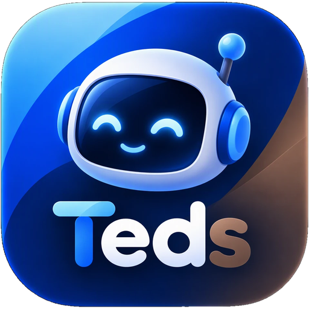
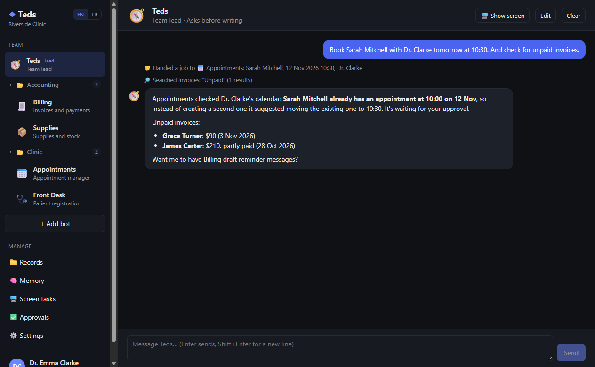
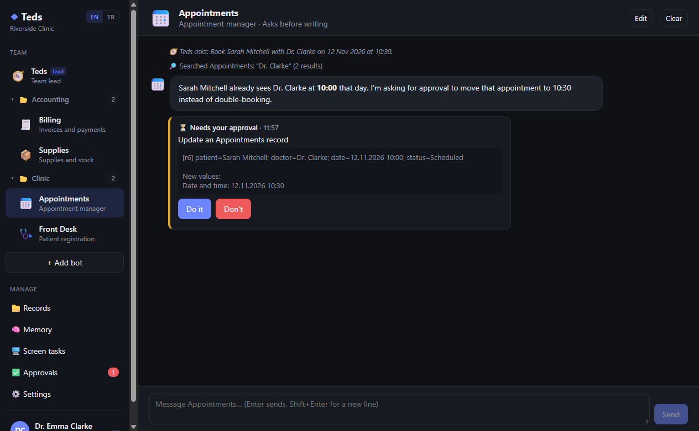
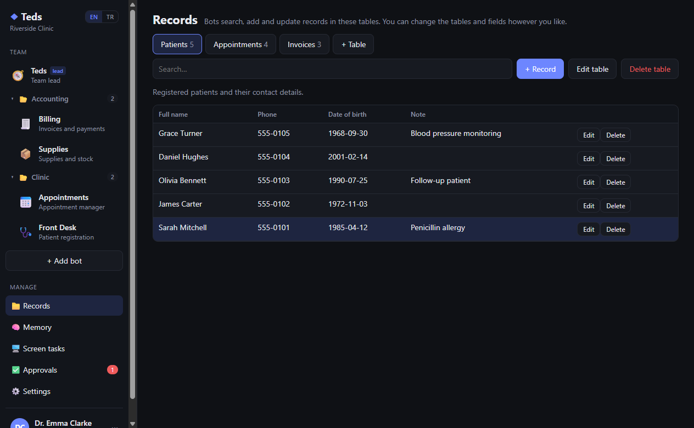
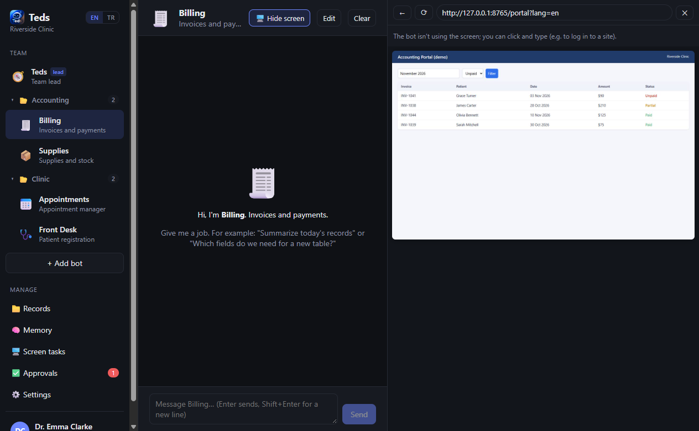
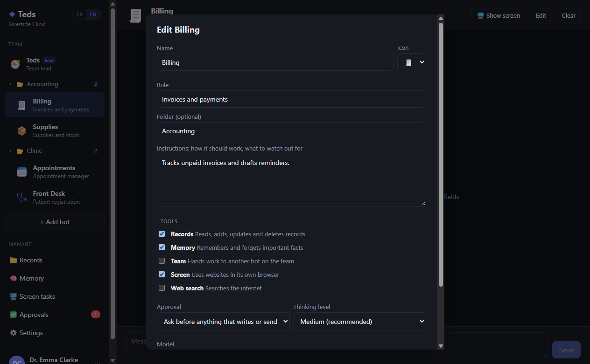
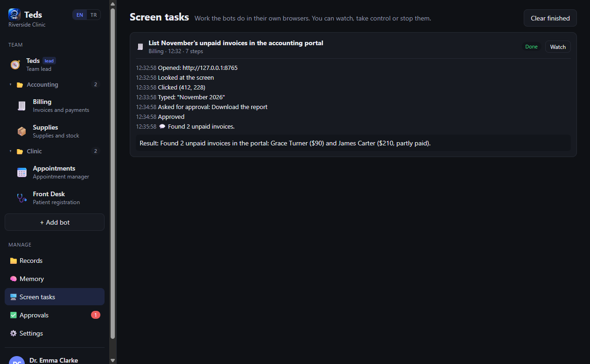
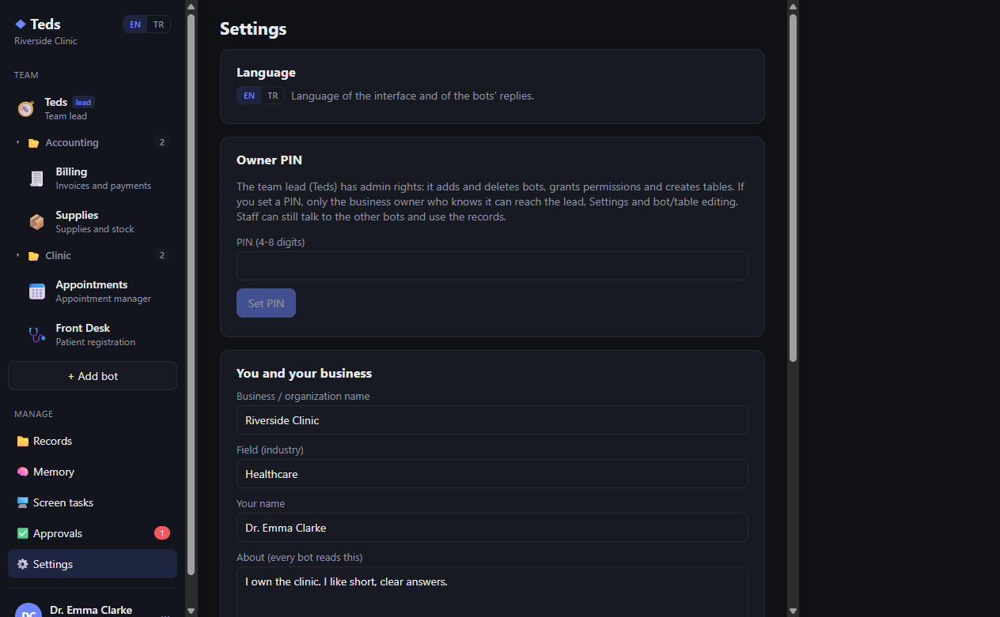
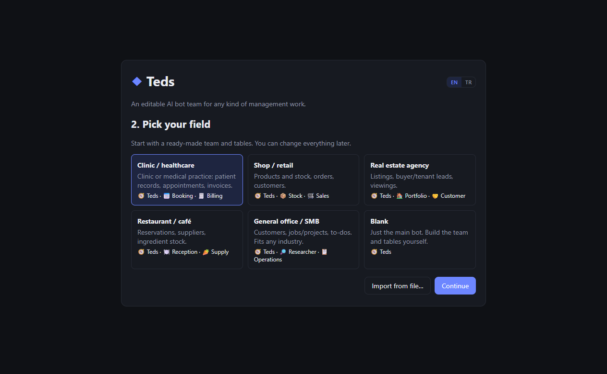
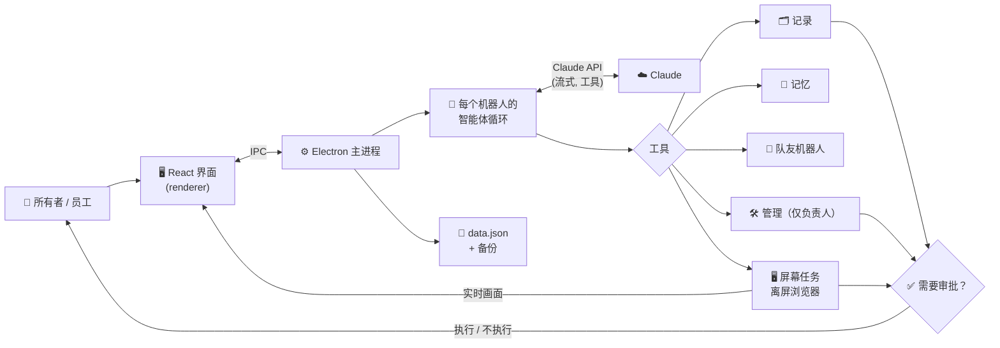

<div align="center">



# Teds

[English](README.md) | [Deutsch](README.de.md) | [Türkçe](README.tr.md) | **简体中文** | [日本語](README.ja.md)

### 适用于各类管理工作、可自由编辑的 AI 机器人团队

**把你的记录、你的规则和一个浏览器交给一支 AI 机器人团队，让它们处理繁琐事务，重要的事由你来批准。**

[](LICENSE)
[](#installation)
[](#architecture)
[](#how-the-bots-work)
[](#languages)
[](#project-status)

*一款 Windows 桌面应用：团队负责人机器人与各专业机器人共享你的记录和共同记忆，相互分派工作，在各自的浏览器中操作网站，并在任何写入、发送或删除操作之前先请你批准。*



</div>

> [!IMPORTANT]
> 🌱 **这是 Teds 的早期首个版本。** 它可以正常运行，适合试用，但仍在持续开发中：功能、数据格式和界面在之后的版本中都可能发生变化。非常欢迎反馈和问题报告。

> [!NOTE]
> 应用界面目前提供**英语**和**土耳其语**。截图展示的是英文界面。

---

## 📑 目录

- [为什么选择 Teds？](#why)
- [适合谁使用？](#audience)
- [截图](#screenshots)
- [功能](#features)
- [机器人如何工作](#how-the-bots-work)
- [架构](#architecture)
- [安装](#installation)
- [使用方法](#usage)
- [语言](#languages)
- [安全与隐私](#security)
- [项目结构](#structure)
- [局限性](#limitations)
- [路线图](#roadmap)
- [项目状态](#project-status)
- [许可证与免责声明](#license)

---

<a id="why"></a>
## 🔍 为什么选择 Teds？

经营一家小企业、诊所或办公室，意味着大量重复性工作：在表格里查找信息、预约和改约、催收未付发票、从网页门户里抄录数字。单个聊天机器人可以谈论这些工作，但它无法保管你的记录、遵守你的规则，也不能放心地让它自行修改数据。

Teds 把这些变成一个**团队**：

- 一个**团队负责人**机器人，理解你的需求并把任务交给合适的专家。
- **专业机器人**（预约、账单、库存、调研……），各自拥有自己的角色、指令和工具。
- **共享记录**（你自己定义的表格）、存放事实与规则的**共享记忆**，以及在任何写入、发送或删除操作前的**审批步骤**。
- **每个机器人都有一个真实的浏览器**，机器人在网页门户中工作时，你可以旁观、接管控制或让它停止。

团队中没有任何内容是写死的。从一个模板开始（医疗、零售、房地产、餐饮、通用办公或空白），然后重命名机器人、改写它们的指令、添加表格和字段，或者干脆让团队负责人替你完成。

---

<a id="audience"></a>
## 👥 适合谁使用？

| 用户群体 | 典型用途 |
| --- | --- |
| **诊所和医疗机构** | 患者登记、带冲突检查的预约、发票跟进。 |
| **商店和小型零售商** | 库存水平与低库存提醒、订单、客户回复。 |
| **房地产中介** | 房源、潜在客户及其需求、看房日程。 |
| **餐厅和咖啡馆** | 订座、食材库存、供应商订单草稿。 |
| **任何办公室和中小企业** | 客户、工作与待办事项、附带来源的网络调研。 |
| **开发者和爱好者** | 一个基于 Claude API 的多智能体桌面应用的易读参考：工具调用、审批、计算机使用（computer use）和上下文管理。 |

---

<a id="screenshots"></a>
## 🖼️ 截图

> 截图使用的是一家**虚构的演示诊所**，患者和发票均为编造，不包含任何真实数据。

| 团队负责人分派并汇报 | 修改前的审批 |
| :---: | :---: |
|  |  |
| **你自己定义的记录** | **机器人自己的浏览器，实时画面** |
|  |  |
| **编辑机器人** | **屏幕任务历史** |
|  |  |
| **设置、语言和所有者 PIN** | **首次运行的模板** |
|  |  |

---

<a id="features"></a>
## 🚀 功能

### 团队

| 方面 | 作用 |
| --- | --- |
| 🧭 **团队负责人** | 由一个机器人领导团队。简单的工作自己完成，专业工作交给队友，然后总结结果。 |
| 🛠️ **负责人兼管理员** | 负责人可以创建、编辑和删除机器人，分配工具和审批模式，并创建或修改表格和字段。扩大权限和删除操作始终需要所有者批准。 |
| 🔒 **仅限所有者的负责人** | 设置所有者 PIN 后，只有业务所有者才能与负责人对话、打开设置或更改团队和表格结构。其他机器人无法联系负责人。闲置 30 分钟后会自动重新锁定。 |
| 🤝 **任务委派** | 拥有*团队*工具的机器人可以向队友求助并等待回复。 |
| 📁 **文件夹** | 在侧边栏中给机器人分组：把一个机器人拖到另一个上面即可创建文件夹，右键单击文件夹即可重命名。 |
| 🧩 **模板** | 医疗、零售、房地产、餐饮、通用办公或空白。可将团队和表格导出为 JSON 并在别处导入（记录和聊天不会导出）。 |

### 工作与安全

| 方面 | 作用 |
| --- | --- |
| 🗂️ **记录** | 由你设计的表格（文本、长文本、数字、日期、选项字段）。机器人可以搜索、添加、更新和删除；你也可以手动编辑。 |
| ✅ **审批** | 每个机器人可以设为在任何写入或发送前询问，或自行执行。无论设置哪种模式，删除和付款始终需要询问。你可以附上说明拒绝，告诉机器人应该改做什么。 |
| 🧠 **共享记忆** | 机器人会保存长期有效的事实和规则（"Clarke 医生周二下午不接诊"）；所有机器人都会读取，你也可以编辑。 |
| 🖥️ **屏幕控制** | 拥有*屏幕*工具的机器人在自己的浏览器窗口中工作：打开页面、查看、点击、输入和滚动。你可以在聊天旁的面板中实时观看、接管控制、交还控制或让它停止。 |
| 🌐 **网络搜索** | 拥有*网络搜索*工具的机器人可以在互联网上搜索。 |
| 💾 **安全存储** | 数据以原子方式保存，并带有自动备份（最多每 10 分钟一次，保留最近 30 份），且能从损坏的数据文件中恢复。 |

---

<a id="how-the-bots-work"></a>
## 🧠 机器人如何工作

每个机器人都是一个 Claude 智能体循环，拥有自己的系统提示词，由以下内容组成：

- 它的角色和你给它的指令，
- 团队成员，
- 表格及其字段，
- 共享记忆，
- 今天的日期和审批规则。

机器人获得哪些工具，取决于你为它启用的工具组：

| 工具组 | 工具 |
| --- | --- |
| 记录 | 列出表格，查找、添加、更新和删除记录 |
| 记忆 | 记住、忘记 |
| 团队 | 询问队友（从不询问负责人） |
| 屏幕 | 使用 Claude 的 computer use 工具集，在机器人自己的浏览器中执行屏幕任务 |
| 网络搜索 | Claude 的服务器端网络搜索 |
| *（仅负责人）* | 列出、创建、更新和删除机器人；创建、更新和删除表格 |

在底层，Teds 使用官方的 Anthropic TypeScript SDK，并启用了：

- 流式输出，
- 可按机器人设置思考强度的自适应思考，
- 提示词缓存，
- 在长时间屏幕任务中清除旧工具结果的上下文编辑。

默认模型是 Claude Opus 5.5。你可以在设置中或为每个机器人单独更改（Sonnet 5.5 是日常使用中不错且更便宜的选择）。

---

<a id="architecture"></a>
## 🏗️ 架构



- **主进程**（`src/main`）：状态与存储、智能体循环、工具、审批、所有者锁以及机器人的浏览器窗口。
- **渲染进程**（`src/renderer`）：React 界面。它只通过一个小型、带类型的 IPC 桥与主进程通信。
- **机器人屏幕**是隐藏的离屏浏览器窗口。它们的画面会实时传输到面板中，你在面板里的点击和按键会被发送回去。

---

<a id="installation"></a>
## 📦 安装

**系统要求**

- Windows 10 或 11
- [Node.js](https://nodejs.org) 22 或更高版本
- 一个来自 [platform.claude.com](https://platform.claude.com/settings/keys) 的 Claude API 密钥（用量由 Anthropic 计费）

**最简单的方式：** 双击项目文件夹中的 **`Teds.cmd`**。首次运行会安装依赖，之后每次运行都会构建并打开应用。

**通过命令行**

```bash
npm install
npm run build
npm start
```

| 脚本 | 作用 |
| --- | --- |
| `npm run dev` | 带热重载的开发模式 |
| `npm run build` | 将应用构建到 `out/` |
| `npm start` | 打开构建好的应用 |
| `npm run typecheck` | 对整个项目进行类型检查 |
| `npm run dist` | 在 `dist/` 中构建 Windows 安装程序（尚未测试） |

---

<a id="usage"></a>
## 🧭 使用方法

1. **首次运行：** 选择语言（EN / TR），粘贴 Claude API 密钥，选择一个模板，并简单介绍一下你的业务。
2. **与机器人对话：** 在侧边栏中选择一个机器人并交给它一项工作，例如 *"帮 Sarah Mitchell 预约明天 10:30 的 Clarke 医生"*。工具步骤会以小提示的形式显示在聊天中。
3. **审批：** 当机器人想要写入、发送或删除时，聊天中和 **Approvals**（审批）页面上会出现 **Do it / Don't**（执行 / 不执行）卡片。
4. **塑造团队：** 使用机器人上的 **Edit**（编辑）、**+ Add bot**（添加机器人）、**Records**（记录）页面，或者直接告诉团队负责人（*"创建一个耗材表，以及一个能使用它的库存机器人"*）。
5. **上锁：** 在 **Settings**（设置）中设置所有者 PIN。员工可以继续使用其他机器人；负责人和设置只归你使用。
6. **观看屏幕任务：** 给拥有*屏幕*工具的机器人布置一个网站上的任务。它的浏览器会在聊天旁打开；用 **Take control**（接管控制）自己点击，或用 **Stop**（停止）让它停下。

你的数据保存在 `%APPDATA%\Teds` 中（`data.json`、`backups\` 以及加密的 `api-key.bin`）。

---

<a id="languages"></a>
## 🌍 语言

Teds 提供**英语**（默认）和**土耳其语**。可在侧边栏、首次运行界面或设置中使用 **EN | TR** 切换。

切换会改变：

- 整个界面，
- 机器人回复所用的语言，
- 它们在聊天中留下的提示，
- 你所应用的模板。

你自己创建的内容（机器人名称、记录、记忆、旧聊天）保持你写下时的样子。

所有源字符串、提示词和代码注释均为英文。土耳其语翻译位于 [`src/shared/i18n.tr.ts`](src/shared/i18n.tr.ts)；没有翻译的内容会回退为英文。添加一种新语言只需再添加一个字典文件。

---

<a id="security"></a>
## 🛡️ 安全与隐私

- **API 密钥**使用 Windows DPAPI（Electron `safeStorage`）加密，并且不会再在界面中显示。
- **所有者 PIN** 只以 scrypt 哈希的形式保存。
- **审批**由应用强制执行，而不是由模型决定。删除、付款和权限变更始终需要人工点击"执行"。
- **网页内容被视为数据。** 机器人被告知不要执行网页或记录中出现的指令，屏幕工具也只会打开 `http`/`https` 地址。这降低了提示词注入的风险，但无法彻底消除，因此对使用网络的机器人请保持审批开启。
- **界面与 Node 隔离**（`contextIsolation`，无 `nodeIntegration`）。链接会在你的普通浏览器中打开。
- **哪些数据会离开你的电脑：** 机器人完成任务所需的消息、记录、记忆和截图会发送到 Claude API。除此之外不会发送任何内容。

> [!WARNING]
> 如果你处理个人数据或健康数据，请在向 Teds 录入真实数据之前，确认你在适用法律（例如 GDPR 或 KVKK）下的义务。

---

<a id="structure"></a>
## 🗂️ 项目结构

| 路径 | 内容 |
| --- | --- |
| `src/shared/types.ts` | 所有共享数据类型 |
| `src/shared/templates.ts` | 行业模板（在这里添加新模板） |
| `src/shared/i18n.ts`, `i18n.tr.ts` | 语言切换和土耳其语字典 |
| `src/main/index.ts` | 应用入口、IPC 处理程序、仅限所有者的检查 |
| `src/main/store.ts` | 状态、保存、备份、所有者 PIN、加密的 API 密钥 |
| `src/main/claude.ts` | Claude 智能体循环：流式输出、工具调用、错误处理 |
| `src/main/agent.ts` | 机器人的系统提示词和工具（记录、记忆、团队、屏幕、网络） |
| `src/main/admin.ts` | 团队负责人的管理工具 |
| `src/main/approvals.ts` | 审批请求与回复 |
| `src/main/screen.ts` | 机器人的离屏浏览器窗口和输入 |
| `src/main/screenTask.ts` | 屏幕任务循环（computer use） |
| `src/renderer/src/` | React 界面 |
| `docs/screenshots/` | README 截图 |
| `Teds.cmd` | Windows 一键启动器 |

---

<a id="limitations"></a>
## ⚠️ 局限性

- **仅限 Windows，单台电脑。** 数据是一个本地文件，尚不支持多人从不同设备同时工作。
- **安装程序（`npm run dist`）尚未测试。** 目前请使用 `Teds.cmd` 或 `npm start`。
- **AI 可能出错。** 机器人可能误解请求或网页。审批有帮助，但重要结果请自行核对。
- **费用**取决于模型和用量。屏幕任务会发送截图，比聊天更贵。
- **尚无自动化测试。**

---

<a id="roadmap"></a>
## 🧭 路线图

以下是后续版本的设想，目前均未承诺。

- 通过浏览器的多用户访问，以及来自企业网站的请求
- 数据库后端（SQLite/PostgreSQL）以及供机器人使用的 SQL 表管理
- 语音输入与语音回复
- 经过测试的 Windows 安装程序和自动更新
- 自动化测试

---

<a id="project-status"></a>
## 🌱 项目状态

这是 Teds 的**首个公开版本**，作为一个起点发布。请预期会有变化：后续版本可能带来新功能、不同的数据格式和重新设计的界面。如果你基于它进行开发，请固定到某个特定的提交。

---

<a id="license"></a>
## 📄 许可证与免责声明

基于 [MIT 许可证](LICENSE) 发布。

Teds 不是医疗器械，也不提供医疗、法律或财务建议。你有责任检查机器人所做的工作，并对你输入应用的数据负责。

Teds 的灵感来自 [Bops](https://github.com/OrgoAI/bops) 背后的理念——一个面向 macOS 的 AI 机器人团队。Teds 为 Windows 从零编写，不包含任何 Bops 代码。
